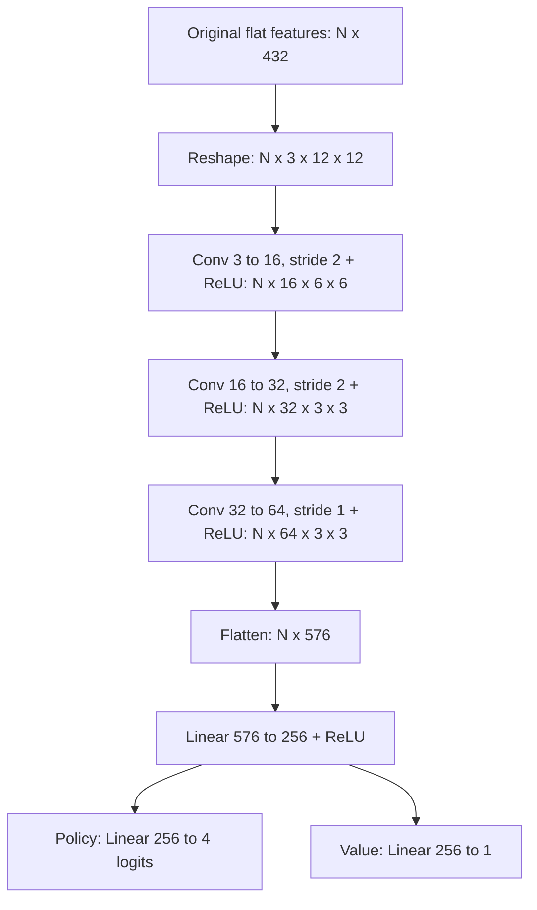

# PPO Snake (Rust)

This project uses a small Snake game to study scaling behavior in reinforcement learning without requiring high-end hardware. A 12×12 environment and compact PPO actor–critic make controlled CPU experiments practical. The experiments study PPO mini-batch size, rollout size, and the number of optimization epochs per rollout.

## E001: Batch and rollout scaling

All runs use training seed 42, 64 rollout steps per environment, a hidden size of 256, one PPO epoch, and a fixed learning rate of `3e-4`. Shared settings are `gamma=0.99`, `gae_lambda=0.95`, `clip_range=0.2`, `value_coef=1`, `entropy_coef=0.001`, and `max_grad_norm=0.5`. Each run has a **1,200M environment-sample cap** and the same early-stopping rule. All six runs have completed; result analysis is pending.

`R = num_envs × rollout_steps` is the amount collected for one PPO update; `b = ppo.batch_size` is the optimization mini-batch size.

| Group | Mini-batch `b` | Rollout `R` | Environments | `R/b` | Comparison |
| --- | ---: | ---: | ---: | ---: | --- |
| A | 256 | 2,048 | 32 | 8 | Small joint-scaling point; compare with D at fixed `b` |
| B | 1,024 | 8,192 | 128 | 8 | Middle joint-scaling point; compare with D at fixed `R` and E at fixed `b` |
| C | 10,240 | 81,920 | 1,280 | 8 | Large joint-scaling point; compare with E at fixed `R` and F at fixed `b` |
| D | 256 | 8,192 | 128 | 32 | Mini-batch effect versus B at `R=8,192` |
| E | 1,024 | 81,920 | 1,280 | 80 | Mini-batch effect versus C at `R=81,920` |
| F | 10,240 | 20,480 | 320 | 2 | Rollout effect versus C at `b=10,240` |

A–B–C repeat joint scaling at constant `R/b=8`. D–B and E–C vary mini-batch size while holding `R` fixed. A–D, B–E, and F–C vary `R` while holding mini-batch size fixed. With one PPO epoch, changing `b` also changes optimizer steps per environment sample; these comparisons describe the combined PPO mini-batch setting. Keep the learning rate and all other parameters fixed for this study.

## E002: PPO epoch scaling

Reuse completed E001 groups A, B, and C as the `epochs=1` baselines. Train nine new runs from scratch with `epochs=2,4,8`, changing only the epoch count and experiment identity relative to each corresponding baseline. The epoch-1 results remain in the E001 W&B group and are not rerun by the E002 sweep.

| Scale | Mini-batch `b` | Rollout `R` | Environments | Existing baseline | New configurations |
| --- | ---: | ---: | ---: | --- | --- |
| A | 256 | 2,048 | 32 | E001 A, epoch 1 | `A-ep2`, `A-ep4`, `A-ep8` |
| B | 1,024 | 8,192 | 128 | E001 B, epoch 1 | `B-ep2`, `B-ep4`, `B-ep8` |
| C | 10,240 | 81,920 | 1,280 | E001 C, epoch 1 | `C-ep2`, `C-ep4`, `C-ep8` |

All shared settings above, including the fixed learning rate, sample cap, evaluation seeds, 25M evaluation interval, 1,024 evaluation episodes, and patience of 12 evaluations, carry over to E002. Configurations are in [config/experiments/epoch_scale](config/experiments/epoch_scale). W&B uses group `E002 epoch scale` and run names such as `E002 epoch scale A-ep2`. Each run has its own checkpoint directory, for example `checkpoints/E002_epoch_scale_A-ep2/`.

An epoch makes one complete pass through the current rollout, with mini-batches reshuffled on each pass. Each scale has `R/b=8`, so epochs 1, 2, 4, and 8 perform 8, 16, 32, and 64 optimizer steps per rollout. At a fixed environment-sample budget, increasing epochs increases data reuse and optimization work. Compare evaluation mean score against environment samples for sample efficiency, and against wall time and optimizer steps for training cost. Compare epoch choices within each scale before comparing their effects across scales. Use common sampled milestones; do not extend stopped curves or treat an early stop as proof of a performance ceiling. Results describe training seed 42 under the fixed `3e-4` learning rate.

Preview, check the LibTorch runtime, and launch all nine new experiments:

```powershell
powershell -NoProfile -ExecutionPolicy Bypass -File scripts/sweep_epoch_scale.ps1 -DryRun
powershell -NoProfile -ExecutionPolicy Bypass -File scripts/sweep_epoch_scale.ps1 -CheckRuntime
powershell -NoProfile -ExecutionPolicy Bypass -File scripts/sweep_epoch_scale.ps1
```

The sweep builds once and runs `A-ep2`, `B-ep2`, `C-ep2`, then the three epoch-4 runs, then the three epoch-8 runs. It stops on failure and refuses to overwrite an existing selected run's `latest.ot`. To start at a particular experiment, run:

```powershell
powershell -NoProfile -ExecutionPolicy Bypass -File scripts/sweep_epoch_scale.ps1 -StartAt B-ep4
```

`-StartAt` launches that experiment and every subsequent experiment from scratch; it does not restore training state. Use `-AllowExistingCheckpoints` only for an intentional rerun that may overwrite checkpoints. To launch one experiment:

```powershell
cargo run --release -- --config config/experiments/epoch_scale/C-ep4.yaml
```

## E003: Batch/rollout switching from existing weights

This study tests whether models trained at smaller scales can recover after switching to a larger scale, and whether models trained at the largest scale retain their performance after switching down. A switch changes mini-batch size, rollout size, and environment count together, keeping `R/b=8`. It does not isolate mini-batch size alone.

Reuse nine E001 epoch-1 checkpoints and run **12 scale-switch branches**. All branches load the complete actor-critic weights and **reset Adam**, the training environments, random generators, rolling metrics, and early-stopping state. This is a weights-only warm start, not a restoration of the original training process.

| Source scale | Nominal source samples | Target scales per checkpoint | Branches |
| --- | --- | --- | ---: |
| A: `b=256`, `R=2,048`, 32 environments | 100M, 300M, 550M | B, C | 6 |
| B: `b=1,024`, `R=8,192`, 128 environments | 200M, 500M, 850M | C | 3 |
| C: `b=10,240`, `R=81,920`, 1,280 environments | 150M, 450M, 850M | B | 3 |

The stages describe the observed source curves, not guaranteed convergence. YAML files reference the actual checkpoint counts after full-rollout rounding; for example, nominal A-100M uses `samples-100001792.ot`, not an invented `samples-100000000.ot`. All nine source files must be copied into their original E001 checkpoint folders before running the complete sweep.

Every branch uses epoch 1, seed 42, fixed learning rate `3e-4`, and the corresponding target scale's E001 settings. Training ends through evaluation-based early stopping, with the original **1,200M additional-sample cap** retained as the maximum for each branch. There is no 300M training cap: approximately 300M is the waiting period without a new evaluation high. The early-stopping rule remains enabled: evaluate every 25M new samples on the same 1,024 held-out seeds, with patience 12. An extra evaluation before the first update establishes the branch's initial score and early-stopping best. No old best score or patience counter is inherited.

The optional training fields are:

```yaml
training:
  max_env_samples: 1200000000      # maximum new samples; early stopping can end sooner
  checkpoint_interval_samples: 50000000
  checkpoint_dir: checkpoints
  init_checkpoint: checkpoints/E001_batch_rollout_scale_exp-A/samples-100001792.ot
  pretrained_env_samples: 100001792
```

`total_samples = pretrained_env_samples + finetune_samples`. The extra `finetune_samples` W&B axis starts at zero; existing sample-axis charts default to cumulative `total_samples`. Select `finetune_samples` as a custom chart x-axis to compare adaptation after a switch. Evaluation, logging, checkpoint scheduling, optimizer-step counts, and wall time count only the new branch's work. Saved checkpoint filenames contain cumulative sample counts. Initialization files are read-only; the trainer rejects an output directory that contains the source checkpoint.

Configurations are in [config/experiments/batch_rollout_switch](config/experiments/batch_rollout_switch). W&B uses group `E003 batch rollout switch`, with names such as `E003 batch rollout switch A-100M-to-B`. Outputs use matching isolated folders such as `checkpoints/E003_batch_rollout_switch_A-100M-to-B/`.

Preview all 12 branches, check the runtime without training, and launch the sweep:

```powershell
powershell -NoProfile -ExecutionPolicy Bypass -File scripts/sweep_batch_rollout_switch.ps1 -DryRun
powershell -NoProfile -ExecutionPolicy Bypass -File scripts/sweep_batch_rollout_switch.ps1 -CheckRuntime
powershell -NoProfile -ExecutionPolicy Bypass -File scripts/sweep_batch_rollout_switch.ps1
```

Runs are ordered by source A/B/C, then early/middle/late. Run a subset or start at a particular branch:

```powershell
powershell -NoProfile -ExecutionPolicy Bypass -File scripts/sweep_batch_rollout_switch.ps1 -SourceGroup A -Stage Late
powershell -NoProfile -ExecutionPolicy Bypass -File scripts/sweep_batch_rollout_switch.ps1 -StartAt B-500M-to-C
cargo run --release -- --config config/experiments/batch_rollout_switch/A-550M-to-C.yaml
```

The sweep checks selected source files and existing output checkpoints before building. It stops if a branch fails. `-AllowExistingCheckpoints` permits an intentional fresh rerun that may overwrite E003 output files; it never resumes an interrupted branch. `-StartAt` applies after source/stage filtering and must name an included branch.

Compare switched branches against the original source- and target-scale baselines at the same cumulative sample count. There are no unchanged-scale restart controls; differences from the original baselines therefore combine the scale change with restarting the optimizer and training state. Plot adaptation against new samples, and report the last four evaluations as well as the complete curves. Compare with existing baselines only over their recorded sample ranges, without extrapolating stopped curves. An early stop does not establish irreversible damage. Conclusions are conditional on resetting Adam and the other training state.

## E004: Feature and model architecture experiments

Experiment A replaces the shared MLP with a CNN while keeping the original head/body/food features and the E001 C training settings. It trains from scratch: batch size **10,240**, epochs **1**, rollout **81,920**, **1,280** environments, hidden size **256**, seed **42**, fixed learning rate **3e-4**, and the same reward, PPO loss, evaluation, and early-stopping rules. The maximum is **1,200M training samples**, with evaluation every **25M**, **1,024** fixed held-out episodes, and patience **12**. The E001 C MLP run is the reference baseline.

Select the feature and model versions independently in YAML:

```yaml
features:
  version: board_v1
model:
  version: cnn_v1
  hidden_size: 256
```

| Selector | Implemented versions | Meaning |
| --- | --- | --- |
| `features.version` | `board_v1` | Unchanged three binary planes: head, body excluding head, food; row-major order, flattened to 432 values on a 12x12 board |
| `model.version` | `mlp_v1`, `cnn_v1` | Original two-layer shared MLP, or shared CNN plus a dense projection |

Omitting either selector uses `board_v1` and `mlp_v1`, preserving old configuration behavior and MLP checkpoint tensor names. Unknown versions are rejected. Feature selection and model construction are applied consistently in rollout collection, training, evaluation, and visual inference. Only the original feature version is implemented in this first experiment; no direction, tail, or body-order features have been added.

CNN v1 uses three 3x3 convolutions with padding 1, ReLU after each, followed by a 256-unit projection and the existing linear policy/value heads:



On the 12x12 board, CNN v1 has **172,581 parameters** versus **177,925** for the original MLP. This keeps parameter counts close, although compute costs and spatial structure differ. The final convolution's nominal receptive field is 15x15, and the dense projection combines all spatial positions. Dimensions are derived from the configured board size. There is no batch normalization, dropout, or change to the PPO optimizer/loss implementation.

The first configuration is [config/experiments/feature_architecture/A.yaml](config/experiments/feature_architecture/A.yaml). It logs to W&B group `E004 feature architecture`, run `E004 feature architecture exp-A`, with checkpoints in `checkpoints/E004_feature_architecture_exp-A/`. Load a CNN checkpoint with the same model/feature versions, board dimensions, and hidden size; existing MLP weights cannot initialize this different architecture.

Preview, check the LibTorch runtime, and launch experiment A:

```powershell
powershell -NoProfile -ExecutionPolicy Bypass -File scripts/sweep_feature_architecture.ps1 -DryRun
powershell -NoProfile -ExecutionPolicy Bypass -File scripts/sweep_feature_architecture.ps1 -CheckRuntime
powershell -NoProfile -ExecutionPolicy Bypass -File scripts/sweep_feature_architecture.ps1
```

The sweep currently discovers only A. Future single-letter configurations in the same folder are discovered in alphabetical order; `-StartAt B` starts at B once it exists. Existing checkpoints are protected unless `-AllowExistingCheckpoints` is explicitly supplied for a fresh rerun. Run individual configs through `cargo run --release -- --config config/experiments/feature_architecture/A.yaml` as usual.

## Sample-based training and stopping

The YAML uses environment samples for the training cap, checkpoint interval, evaluation interval, and W&B upload interval. Early stopping counts evaluations. The outer PPO iteration remains an internal loop counter. A run can exceed its configured sample cap by less than one rollout `R`, because an update consumes a complete rollout.

All six ready-to-run configurations are in [config/experiments/batch_rollout](config/experiments/batch_rollout). Pass the desired experiment file explicitly. To launch group C:

```powershell
cargo run --release -- --config config/experiments/batch_rollout/C.yaml
```

Early stopping follows the deterministic evaluation mean score. Evaluation runs every **25M environment samples** on the same **1,024 held-out seeds**, starting at `seed + 1,000,003`; the training environments start at `seed` and use at most 1,280 distinct initial seeds in this study. Each new strict high resets the counter; **12 consecutive evaluations without a new high** stop training (approximately 300M further samples). The 1,200M sample cap remains the maximum. This rule is an experimental heuristic and may miss a later rebound; an early stop does not establish a performance ceiling.

Periodic and final checkpoints save `checkpoints/<safe_run_name>/samples-<total_samples>.ot` and `latest.ot` (for example, `checkpoints/E001_batch_rollout_scale_exp-C/latest.ot`). No checkpoint is selected as the best model. Evaluation uses 1,024 deterministic episodes with the same evaluation seeds at every checkpoint and across groups, capped at 5,000 steps per episode. Checkpoints are scheduled every 50M environment samples; evaluation is scheduled every 25M.

To run groups A–F sequentially on Windows, preview the sweep, check the runtime dependencies without starting training, and then launch:

```powershell
powershell -NoProfile -ExecutionPolicy Bypass -File scripts/sweep_batch_rollout.ps1 -DryRun
powershell -NoProfile -ExecutionPolicy Bypass -File scripts/sweep_batch_rollout.ps1 -CheckRuntime
powershell -NoProfile -ExecutionPolicy Bypass -File scripts/sweep_batch_rollout.ps1
```

The script builds once and adds the bundled LibTorch DLL directory to `PATH` before starting the release binary. The `usage` line printed during `-CheckRuntime` is expected. The sweep stops if a group fails. Use `-StartAt D` to start from D through F. It refuses to run when a selected group's `latest.ot` already exists; use `-AllowExistingCheckpoints` only when intentionally rerunning that group, because its checkpoint files will be overwritten.

## W&B metrics

The six runs share W&B group `E001 batch rollout scale`, with run names `E001 batch rollout scale exp-A` through `exp-F`. All W&B curves use `total_samples` as the x-axis. There is no `recent_samples/*` group or iteration-axis duplicate.

- `train_samples/mean_episode_score`, `std_episode_score`, `min_episode_score`, and `max_episode_score` describe the **most recent 1,024 completed games**. This is a rolling episode window. Before the first completed game, these fields are omitted. `score_window_episode_count` shows how many games currently fill the window.
- Other `train_samples/*` diagnostics are pooled or sample-weighted over the roughly **1M environment samples since the previous upload**. `completed_episode_count` counts games completed during that upload interval, while `window_samples` reports its actual size. These counts do not define the rolling score window.
- `eval_samples/mean_score`, `std_score`, `min_score`, and `max_score` describe the fixed-seed evaluation episodes. `best_mean_score`, `stale_evaluations`, and `early_stop_triggered` show the evaluation-based stopping state. There is no separate `early_stop_samples/*` window group.

PPO diagnostics include positive policy `entropy` (not entropy loss), `policy_loss`, `value_loss`, `total_loss`, `critic_explained_variance`, `policy_approx_kl`, and `clip_fraction`. The `raw_adv_mean/std` values are GAE advantages **before** normalization; `return_mean/std` describe the value targets. `reverse_action_rate` counts requested reverse actions, which the environment ignores. Cumulative optimizer steps, wall time, and sample throughput help compare compute costs. Approximate KL and clip fraction are measured before each mini-batch optimizer step; they are not full-rollout post-update diagnostics.

## Setup (Windows)

1. Install the stable Rust toolchain with the MSVC target.
2. For GPU training, install an NVIDIA driver and a CUDA runtime compatible with LibTorch.
3. Set `LIBTORCH` to a LibTorch 2.7 installation compatible with `tch = 0.20`, and add its `lib` directory to `PATH`. The project's `download-libtorch` feature is useful for CPU compilation and tests.
4. Install the W&B Python SDK with `C:\Users\Liuluotu\Anaconda\anaconda3\python.exe -m pip install "wandb>=0.22.3"`. Configure `WANDB_API_KEY` or run `wandb login` for online logging.

If online W&B access needs an HTTP proxy, set `HTTP_PROXY` and `HTTPS_PROXY` in the same PowerShell window used to launch the sweep. Use the numeric HTTP or mixed port configured in your proxy application. The child PowerShell, Rust trainer, and Python bridge inherit these environment variables. A proxy URL must contain a real numeric port, not placeholder text. Alternatively, set the experiment YAML's `wandb.mode` to `offline` to keep local metrics for later synchronization.

Eating one food item gives reward `1.0`; all other outcomes, including death, give `0.0`.

## Visual inference

Set `mode: infer` and choose `inference.model_path` in a YAML config, then run the program with that config. The window displays the snake, food, current score, and best score; close it to exit.

## Verification

```powershell
cargo fmt --all -- --check
cargo test --all-targets
```
