# PPO Snake: experiments in reinforcement learning scaling

This project uses a simple **12×12 Snake game to explore reinforcement learning scaling behavior on accessible hardware**. CPU PPO baselines and small models on a laptop GPU make it possible to study batch size, rollout size, data reuse, training history, features and model architecture without a large compute cluster.

The initial snake length is 3, so a full board corresponds to **141 food items / score**, not 144. The goal is to understand what changes learning speed, achieved score and stability. These experiments explore scaling behavior; they do not establish a universal scaling law.

## Results at a glance

This report covers **32 W&B runs and 26,717 complete metric-history rows**, downloaded on **2026-11-09** from the [ppo-snake project](https://wandb.ai/xlz1014361885-tokyo/ppo-snake). All runs use training seed **42**. Results describe these observed trajectories, with no estimate of variation across training seeds.

- **Batch size matters under this PPO configuration.** E001 A/B/C achieved best observed eval scores of **67.94 / 102.48 / 110.65**. Comparisons at fixed rollout support a mini-batch effect; increasing rollout by itself does not consistently help.
- **More PPO epochs are not an automatic improvement.** At 300M samples, scale A scored **58.03** with one epoch but **1.84** with eight. Large-batch C tolerated two or four epochs much better than A/B, with little change in the late score range.
- **Training history matters.** After switching the complete scale, B→C can reach roughly 110, while the A→C schedules observed here end around 76–94. A late C→B switch can retain scores above 100. A larger batch does not erase every training-history effect within the observed budget.
- **The earlier MLP score range is not the game's model ceiling.** E004 base reached **132.94 at 400M**, and small + teacher KL reached **131.55 at 925M**. Both runs are marked **`crashed` / incomplete** in W&B; these are last observed evaluations, not completed-run guarantees.

The [per-run catalog](docs/analysis/run-catalog.md) includes the design, plot, result and interpretation for **every run**. Exact numbers and logged configurations are available in [run_results.csv](docs/analysis/data/run_results.csv), [eval_history.csv](docs/analysis/data/eval_history.csv), and [run_configs.json](docs/analysis/data/run_configs.json). Implementation details and feature layouts are in the [technical guide](docs/technical-guide.md).

## How to read the comparisons

The primary strength metric is **held-out deterministic `eval_samples/mean_score`**, measured on the same **1,024 evaluation seeds**, with a 5,000-step cap per game. Stochastic training scores use the latest 1,024 completed training games; they help diagnose learning but are not interchangeable with eval.

Evaluation curves below are **raw and unsmoothed**. Training diagnostic plots show faint raw values plus a causal EMA with a **25M-sample half-life**, except where a figure explicitly states 5M or 10M. No curve is extended after a run ends. `M` means one million environment transitions, and displayed sample counts are rounded; the CSV retains exact counts.

**Last eval** is the last recorded evaluation, which can precede the last training upload. **Last 4 evals** is the arithmetic mean of the last four evaluation means; it describes a short tail of the trajectory, not four independent training repetitions. **Best eval** is the maximum observed evaluation mean, shown to reveal peaks and regressions. It is an optimistic, retrospectively selected diagnostic, not an independently verified model-selection score. Different stopping times make endpoint-only rankings incomplete; common-sample comparisons and the full curves are included for that reason.

Shared PPO settings are LR **3e-4**, gamma **0.99**, GAE lambda **0.95**, clipping range **0.2**, value coefficient **1**, entropy coefficient **0.001**, and rollout horizon **64**. The MLP has two 256-unit hidden layers and the original head/body/food planes. Evaluation is scheduled every **25M** samples; **12 consecutive evaluations without a strict new high** trigger early stopping. The cap is **1,200M new samples**, with a possible overshoot below one rollout. Early stopping is a budget heuristic, not evidence of an irreversible ceiling.

## E001 — Mini-batch and rollout size

**Question.** Does the benefit of increasing the joint training scale come from mini-batch size `b`, rollout size `R`, or both? `R = num_envs × 64`. A/B/C keep `R/b=8`. D/E/F provide comparisons that hold one factor fixed. All use one PPO epoch and the same MLP.

| Run | Mini-batch b | Rollout R | Envs | Eval @300M | Eval @600M | Last eval | Last 4 evals | Best eval (at M) | End M / reason |
| --- | --- | --- | --- | --- | --- | --- | --- | --- | --- |
| [A](https://wandb.ai/xlz1014361885-tokyo/ppo-snake/runs/8qn5aaor) | 256 | 2,048 | 32 | 58.03 | 66.26 | 57.39 | 61.69 | 67.94 (550) | 850 / eval early stop |
| [B](https://wandb.ai/xlz1014361885-tokyo/ppo-snake/runs/1fl1l7hm) | 1,024 | 8,192 | 128 | 78.38 | 95.23 | 98.56 | 97.82 | 102.48 (875) | 1175 / eval early stop |
| [C](https://wandb.ai/xlz1014361885-tokyo/ppo-snake/runs/pqn9f1sl) | 10,240 | 81,920 | 1,280 | 86.44 | 95.87 | 103.24 | 106.19 | 110.65 (1050) | 1200 / sample cap |
| [D](https://wandb.ai/xlz1014361885-tokyo/ppo-snake/runs/imrudw4e) | 256 | 8,192 | 128 | 56.90 | 48.16 | 60.92 | 58.16 | 65.83 (425) | 725 / eval early stop |
| [E](https://wandb.ai/xlz1014361885-tokyo/ppo-snake/runs/ywj4sihn) | 1,024 | 81,920 | 1,280 | 62.82 | 77.06 | 98.21 | 84.71 | 101.03 (825) | 1125 / eval early stop |
| [F](https://wandb.ai/xlz1014361885-tokyo/ppo-snake/runs/9ag8xl46) | 10,240 | 20,480 | 320 | 76.70 | 87.74 | 96.64 | 97.17 | 99.58 (1125) | 1200 / sample cap |

### Joint scale: A, B and C

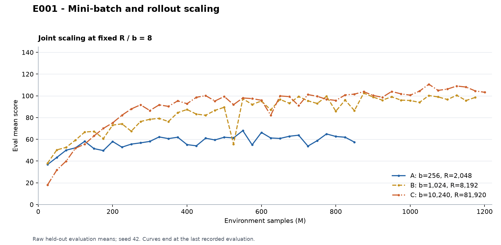

At the common **300M** budget, A/B/C score **58.03 / 78.38 / 86.44**. At **600M**, B and C are much closer (**95.23 vs 95.87**), while A remains lower. Larger scale is associated with a higher late score range, but its advantage changes with training time. The data do not show that every point on the larger-scale curve is better.

### Holding rollout fixed

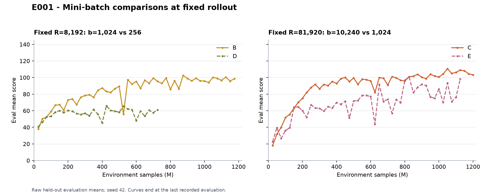

- At **R=8,192**, B (`b=1,024`) scores **95.23** at 600M versus D (`b=256`) at **48.16**.
- At **R=81,920**, C (`b=10,240`) scores **95.87** at 600M versus E (`b=1,024`) at **77.06**.

These comparisons support a mini-batch contribution under the fixed learning rate and optimizer used here. They do **not** isolate gradient variance as the mechanism: at fixed samples, a smaller mini-batch also performs more Adam steps (`steps ≈ samples × epochs / b`).

### Holding mini-batch fixed

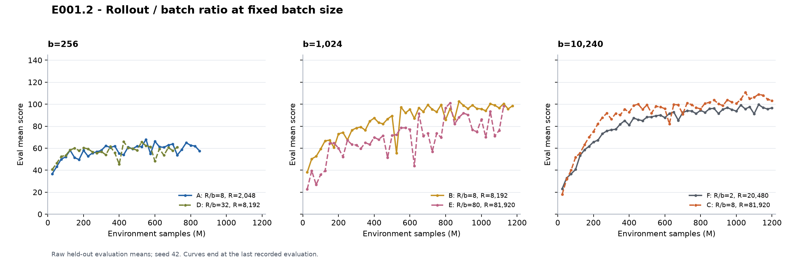

Increasing R is not uniformly helpful. A→D at `b=256` does not raise the observed best score, and B→E at `b=1,024` learns more slowly through much of the curve. At `b=10,240`, C's larger rollout finishes at **103.24** versus F's **96.64** at the same 1,200M budget. Rollout effects depend on mini-batch size. Changing R here also changes the number of parallel environments, so it combines policy-refresh frequency and trajectory-diversity effects.

### Diagnostics and conclusion

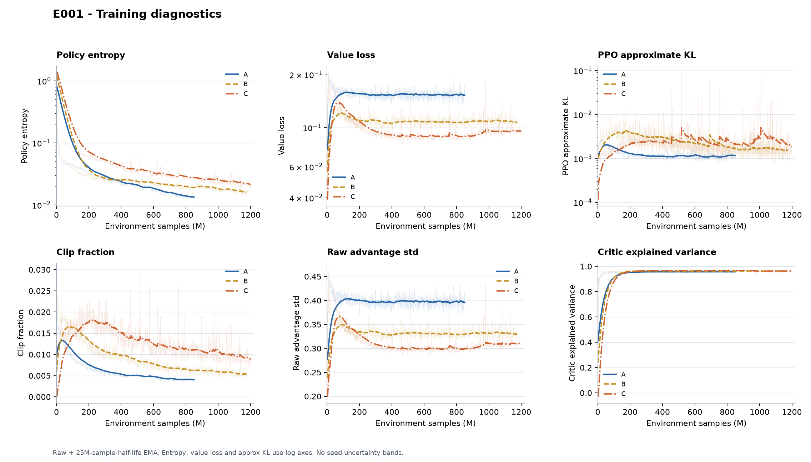

In the common **500–600M** window, mean value loss is approximately **0.154 / 0.109 / 0.090** for A/B/C; entropy is **0.0186 / 0.0229 / 0.0345**, and raw advantage std is **0.398 / 0.332 / 0.300**. This is consistent with lower value-target error and more stochastic policies at larger scale. These measurements use different learned state distributions and are not a causal explanation. Approximate KL is also not uniformly lower for larger batches.

**Conclusion:** with this fixed-LR, epoch-1 protocol, increasing mini-batch size is a stronger and more consistent direction than increasing rollout alone. The factorial comparisons support that distinction. The available sample budget and early stopping do not prove an absolute, irrecoverable performance ceiling.

## E002 — PPO epochs

**Question.** How much can each rollout be reused before more optimizer updates become harmful? Each A/B/C baseline from E001 is compared with **2, 4 and 8 epochs**, with its mini-batch, rollout, learning rate and model unchanged. More epochs multiply optimizer work per environment sample, so this is a sample-budget comparison, not equal compute.

| Scale / epochs | Eval @300M | Last eval | Last 4 evals | Best eval | End M | Reason |
| --- | --- | --- | --- | --- | --- | --- |
| [A, epoch 1](https://wandb.ai/xlz1014361885-tokyo/ppo-snake/runs/8qn5aaor) | 58.03 | 57.39 | 61.69 | 67.94 | 850 | eval early stop |
| [A, epoch 2](https://wandb.ai/xlz1014361885-tokyo/ppo-snake/runs/243228id) | 61.98 | 35.25 | 31.49 | 62.08 | 825 | eval early stop |
| [A, epoch 4](https://wandb.ai/xlz1014361885-tokyo/ppo-snake/runs/cxnzx3v7) | 15.64 | 19.14 | 11.96 | 39.50 | 375 | eval early stop |
| [A, epoch 8](https://wandb.ai/xlz1014361885-tokyo/ppo-snake/runs/gs8jmhi1) | 1.84 | 1.15 | 1.74 | 19.73 | 325 | eval early stop |
| [B, epoch 1](https://wandb.ai/xlz1014361885-tokyo/ppo-snake/runs/1fl1l7hm) | 78.38 | 98.56 | 97.82 | 102.48 | 1175 | eval early stop |
| [B, epoch 2](https://wandb.ai/xlz1014361885-tokyo/ppo-snake/runs/w82bujg6) | 69.05 | 69.12 | 68.99 | 71.57 | 575 | eval early stop |
| [B, epoch 4](https://wandb.ai/xlz1014361885-tokyo/ppo-snake/runs/vyhvyz65) | 54.60 | 62.68 | 64.01 | 70.87 | 425 | eval early stop |
| [B, epoch 8](https://wandb.ai/xlz1014361885-tokyo/ppo-snake/runs/27bpgubc) | 17.29 | 1.06 | 2.96 | 41.85 | 425 | eval early stop |
| [C, epoch 1](https://wandb.ai/xlz1014361885-tokyo/ppo-snake/runs/pqn9f1sl) | 86.44 | 103.24 | 106.19 | 110.65 | 1200 | sample cap |
| [C, epoch 2](https://wandb.ai/xlz1014361885-tokyo/ppo-snake/runs/lawmpttr) | 88.44 | 107.87 | 105.63 | 107.92 | 1200 | sample cap |
| [C, epoch 4](https://wandb.ai/xlz1014361885-tokyo/ppo-snake/runs/os6nv8lh) | 88.97 | 103.44 | 104.35 | 107.13 | 1200 | sample cap |
| [C, epoch 8](https://wandb.ai/xlz1014361885-tokyo/ppo-snake/runs/iknka9jp) | 83.22 | 57.95 | 51.22 | 95.14 | 1000 | eval early stop |

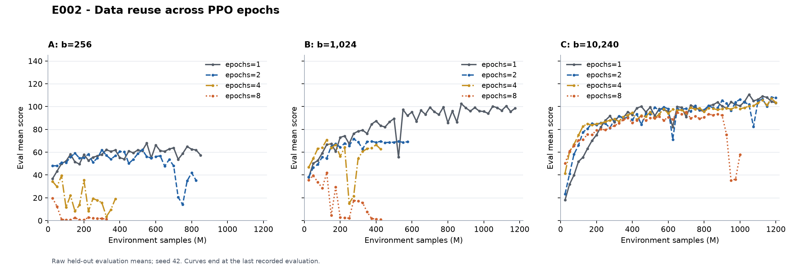

**A:** two epochs slightly improve the 300M score (**61.98 vs 58.03**) but later regress; four and eight epochs perform poorly. **B:** all tested epoch increases are worse than epoch 1 at the common 300M point; eight epochs ends near score 1. **C:** two and four epochs achieve roughly the same late score range as epoch 1. Epoch 2 has a higher last eval (**107.87 vs 103.24**), while its last-four mean (**105.63**) is slightly below epoch 1 (**106.19**). The ranking depends on which point is selected. Eight epochs eventually regresses substantially.

### What the A-epoch-2 collapse does and does not show

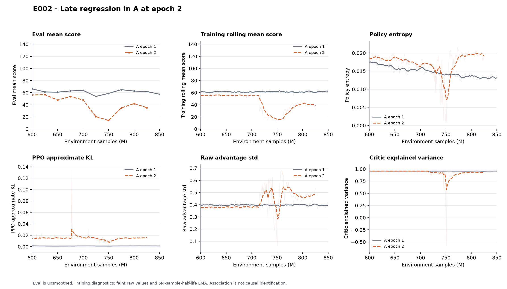

The eval mean drops from **48.03 at 700M** to **13.99 at 750M**, then partly recovers to **41.91 at 800M**. Training scores also decline, so this is not solely a deterministic-evaluation artifact. In the **650–700M** window, epoch-2 approximate KL averages about **0.0175**; during **750–775M**, raw advantage std averages **0.519** and critic explained variance averages **0.814**, versus roughly **0.380 / 0.957** before the sharp regression. Entropy is low, but later rises during partial recovery; its trajectory alone does not identify the cause.

The joint pattern is **consistent with excessive policy updating and a deteriorating critic interacting**, but it does not establish which process initiated the regression. PPO's clipping objective is not a hard KL bound, and these logged KL estimates are pre-mini-batch diagnostics, not full-rollout post-update distances. Proving a mechanism would require additional measurements or a controlled change.

**Conclusion:** retain epoch 1 as the conservative baseline for A/B. C tolerates moderate reuse, but these runs do not establish a robust late-score gain from epochs 2–4. An epoch increase without controlling learning rate or policy movement is not a free scaling improvement.

## E003 — Switching the complete batch/rollout scale

**Question.** Can a policy trained at one scale recover or retain performance after the scale changes? Each branch loads an existing weights-only checkpoint, **resets Adam**, and switches the complete A/B/C scale while retaining `R/b=8`. A→B and A→C use nominal switch points **100/300/550M**; B→C uses **200/500/850M**; C→B uses **150/450/850M**. These points were chosen separately for the source curves, not as universal early/middle/late fractions.

Every branch has up to **1,200M additional** samples, with the same eval-based early stopping. There is no 300M hard cap. The initial evaluation at the switch is included. Actual source counts can differ from nominal names by less than one source rollout.

| Schedule | At switch | After +300M | Last eval | Last 4 evals | Best eval | End M: total / additional |
| --- | --- | --- | --- | --- | --- | --- |
| [A-100M-to-B](https://wandb.ai/xlz1014361885-tokyo/ppo-snake/runs/dqjtc7nx) | 52.12 | 67.61 | 67.91 | 67.65 | 70.17 | 975 / 875 |
| [A-100M-to-C](https://wandb.ai/xlz1014361885-tokyo/ppo-snake/runs/kg14yclt) | 52.12 | 68.30 | 83.95 | 77.28 | 83.95 | 1300 / 1200 |
| [A-300M-to-B](https://wandb.ai/xlz1014361885-tokyo/ppo-snake/runs/0kz667ok) | 58.03 | 60.13 | 69.10 | 66.86 | 69.54 | 825 / 525 |
| [A-300M-to-C](https://wandb.ai/xlz1014361885-tokyo/ppo-snake/runs/4rq43nzz) | 58.03 | 69.71 | 93.87 | 95.38 | 98.46 | 1500 / 1200 |
| [A-550M-to-B](https://wandb.ai/xlz1014361885-tokyo/ppo-snake/runs/tsuw61ly) | 67.94 | 71.32 | 72.07 | 70.53 | 72.22 | 1700 / 1150 |
| [A-550M-to-C](https://wandb.ai/xlz1014361885-tokyo/ppo-snake/runs/7436yevl) | 67.94 | 72.22 | 75.60 | 76.58 | 77.98 | 1750 / 1200 |
| [B-200M-to-C](https://wandb.ai/xlz1014361885-tokyo/ppo-snake/runs/tgfr335x) | 73.01 | 84.06 | 97.71 | 99.09 | 101.61 | 1400 / 1200 |
| [B-500M-to-C](https://wandb.ai/xlz1014361885-tokyo/ppo-snake/runs/14fyacu6) | 89.45 | 100.25 | 108.12 | 108.75 | 110.61 | 1700 / 1200 |
| [B-850M-to-C](https://wandb.ai/xlz1014361885-tokyo/ppo-snake/runs/myl98rs7) | 86.43 | 106.37 | 106.01 | 105.08 | 107.42 | 1325 / 475 |
| [C-150M-to-B](https://wandb.ai/xlz1014361885-tokyo/ppo-snake/runs/atb499b6) | 63.12 | 97.18 | 97.53 | 92.73 | 98.32 | 625 / 475 |
| [C-450M-to-B](https://wandb.ai/xlz1014361885-tokyo/ppo-snake/runs/27xxfqi2) | 100.13 | 93.82 | 93.82 | 94.62 | 100.13 | 750 / 300 |
| [C-850M-to-B](https://wandb.ai/xlz1014361885-tokyo/ppo-snake/runs/op3gdb5t) | 101.57 | 102.06 | 105.31 | 103.14 | 108.28 | 1700 / 850 |

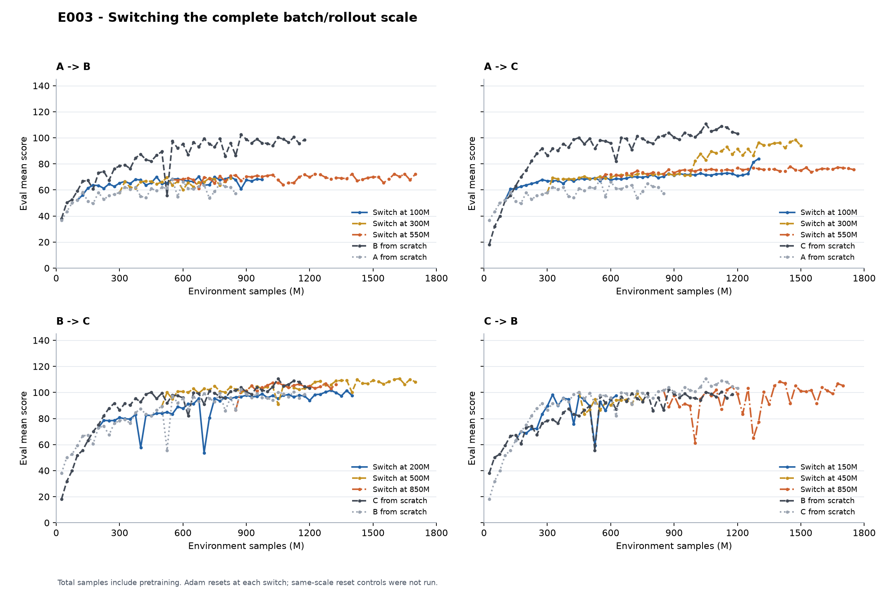

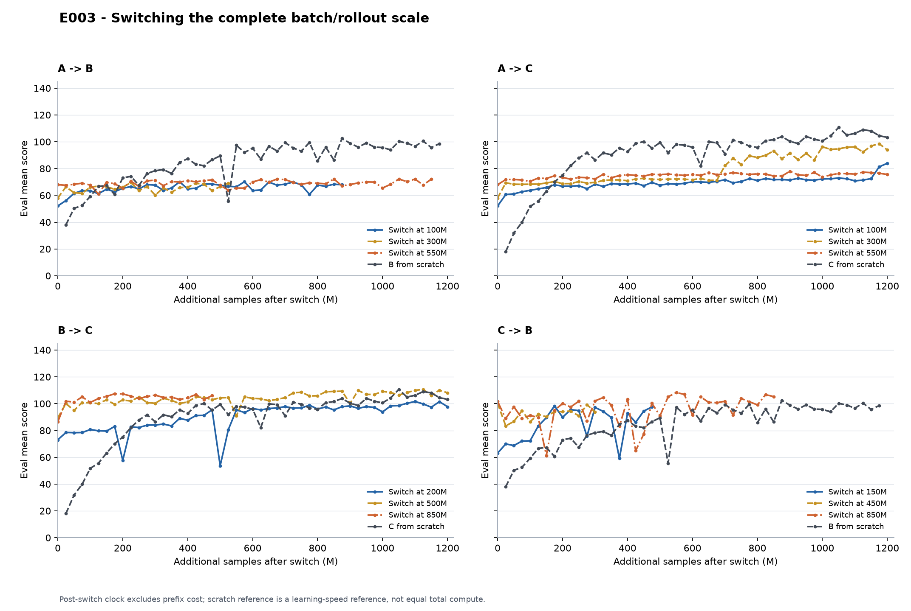

The first plot charges pretraining to the total sample clock. The second shows adaptation after switching; the from-scratch reference there excludes the branch's prefix cost and must not be read as an equal-total-budget comparison.

- **A→B:** the branches improve on their initial score, but remain around 67–72 in their last-four means rather than reaching B-from-scratch's late range near 98.
- **A→C:** recovery is incomplete and non-monotonic in switching time. The 300M switch ends at **93.87**, the 100M switch at **83.95**, and the 550M switch at **75.60**. Earlier switching is not always better in these trajectories.
- **B→C:** the 500M switch reaches **110.61**, close to C-from-scratch's best **110.65**, and ends at **108.12**. The 850M switch reaches **107.42** after a shorter adaptation. Medium-scale pretraining can therefore be followed by strong large-scale performance in this sample.
- **C→B:** lowering the scale does not immediately erase high performance. The 850M branch ends at **105.31**, whereas the 450M branch falls from **100.13** initially to **93.82**, stops after +300M, and never exceeds its initial evaluation.

**Conclusion:** the attained policy depends on its training path as well as its current scale. Recovery is observed, but it is not guaranteed within a fixed continuation budget. Because same-scale Adam-reset controls were deliberately not run, these comparisons do not isolate the effect of changing scale from optimizer reset. Their endpoints also use different total budgets; this is evidence about schedules, not proof of an optimal switch time or an irreversible small-batch trap.

## E004 — Features, architecture and evaluation-best teacher KL

**Question.** Can a better representation/model exceed the MLP score range, and can a frozen best-eval teacher reduce the small model's regression? All logged E004 runs use `b=10,240`, `R=81,920`, epoch 1 and the shared PPO/eval protocol.

**Historical names matter.** The W&B run called `exp-B` is **`transformer_v3`**, an earlier seven-feature grid model. `exp-B-v7` is the entity **small** architecture now named `transformer_v1_small`. The current B YAML selects small; it does not reproduce the historical `exp-B` run. C is the base entity model. D is small plus teacher KL. The report uses the configurations stored with the runs, not today's YAML as a substitute for history.

| Run | Logged model version | Experiment | Eval @300M | Last eval | Last 4 evals | Best eval | Logged / eval M | Status |
| --- | --- | --- | --- | --- | --- | --- | --- | --- |
| [A](https://wandb.ai/xlz1014361885-tokyo/ppo-snake/runs/k7ceg6iz) | `cnn_v1` | CNN, original 3 planes | 51.06 | 74.42 | 72.49 | 75.23 | 1200 / 1200 | sample cap |
| [B](https://wandb.ai/xlz1014361885-tokyo/ppo-snake/runs/tinpghgt) | `transformer_v3` | Historical grid Transformer, 7 features | 30.98 | 30.98 | 20.75 | 33.80 | 311 / 300 | ended before configured cap |
| [B-v7](https://wandb.ai/xlz1014361885-tokyo/ppo-snake/runs/7w4f2mfc) | `transformer_v7` | Entity Transformer small, no teacher | 104.33 | 71.62 | 82.44 | 125.55 | 575 / 575 | eval early stop |
| [C](https://wandb.ai/xlz1014361885-tokyo/ppo-snake/runs/jokwhg5k) | `transformer_v1_base` | Entity Transformer base, no teacher | 121.10 | 132.94 | 130.21 | 132.94 | 419 / 400 | crashed (partial) |
| [D](https://wandb.ai/xlz1014361885-tokyo/ppo-snake/runs/y7o6jbpw) | `transformer_v1_small` | Entity Transformer small + teacher KL | 109.01 | 131.55 | 125.65 | 131.90 | 925 / 925 | crashed (partial) |

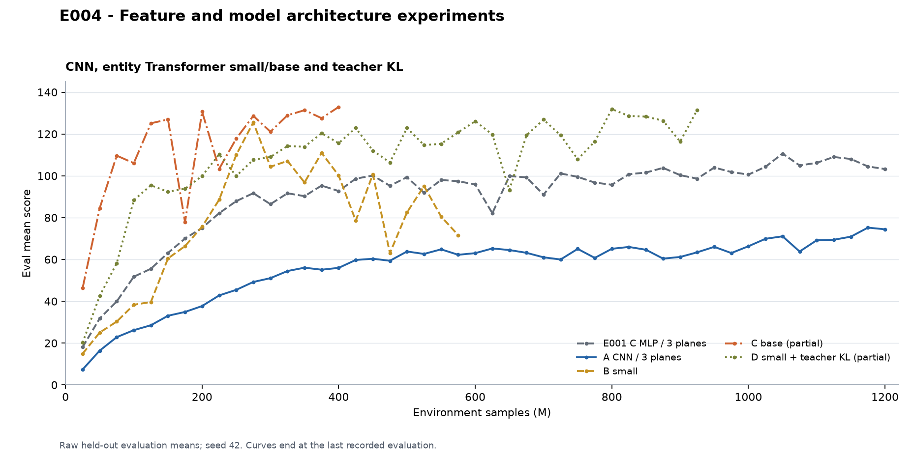

The CNN uses only the original three planes and ends at **74.42**, below the MLP's **103.24** at 1,200M. The early seven-feature Transformer is unstable and ends early at **30.98**; it is not evidence that the later entity Transformers fail. The entity models use **144 Cell + Snake + Food + Global tokens**, with **66/21/24/8** respective raw feature dimensions. Small uses input→32→16 MLPs and 2 encoders; base uses input→64→32 and 3 encoders, retaining a 256-unit actor/critic readout. These models change both representation and architecture relative to the MLP, so this study does not identify which individual feature supplies the gain.

For a common sample-clock comparison:

| Run | Eval @300M | Eval @400M | Eval @575M |
| --- | --- | --- | --- |
| E001 C MLP | 86.44 | 92.71 | 97.42 |
| E004 B-v7 small | 104.33 | 100.17 | 71.62 |
| E004 C base | 121.10 | 132.94 | — (interrupted) |
| E004 D small + KL | 109.01 | 115.61 | 120.82 |

The base model reaches **132.94** at 400M, while the MLP is **92.71** at that point. This is evidence that the earlier MLP range was not a game-level performance ceiling. C's history ends at 419M training samples, with its last eval at 400M; D ends at 925M. Both have W&B state `crashed`. A training exception log was unavailable for these runs, so the interruption causes remain unknown. C also has a sharp training-score drop after its last eval: the rolling mean falls to **18.49 at 409M**, then recovers to **129.32 at 419M**. No later held-out eval confirms the state after that event. A high last eval does not prove future stability or convergence. The 5,000-step evaluation cap is also part of what these scores measure.

The stronger representations also cost more in these recorded jobs. Logged training wall time is about **3.16 h** for the MLP's 1,200M samples, **10.17 h** for base's 419M, and **17.31 h** for D's 925M. These are observed job times across CPU/CUDA and evolving implementations, not a controlled hardware-speed comparison. Higher score is not synonymous with lower computational cost.

### D: frozen evaluation-best self-teacher

Starting from B's small-model configuration, D adds

```yaml
teacher_kl:
  enabled: true
  coef: 0.001
```

The objective is **`L_PPO + coef × mean_s KL(teacher(.|s) || student(.|s))`**, evaluated on student rollout states. The first scheduled eval initializes the teacher. Each later strict new eval high copies the student into the frozen teacher; ties/regressions keep it. There is no critic distillation, coefficient decay, or student/Adam reset. `teacher.ot` stores this teacher; `latest.ot` remains the current student.

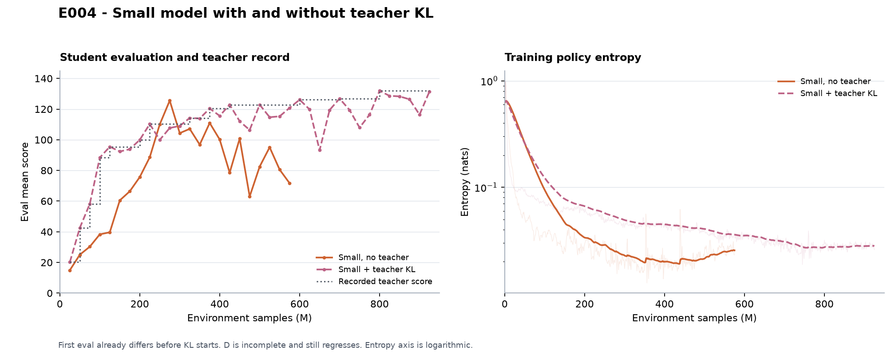

The no-teacher small run peaks at **125.55 at 275M**, then ends at **71.62 at 575M**. D scores **120.82 at the same 575M point**, a **49.20-point** difference, and later reaches **131.90**, with last eval **131.55**. Its teacher is replaced **14 times**, including initialization. D still has regressions, notably **93.19 at 650M**; the penalty is not a monotonic-performance guarantee.

**Attribution remains limited.** The first eval already differs before KL has been applied (**14.94 without teacher vs 20.19 in D**). The runs share nominal configuration and seed, but are not identical pre-intervention trajectories. Consequently, the higher score and better observed retention in D support further investigation of teacher KL, rather than proving that KL alone caused the full improvement.

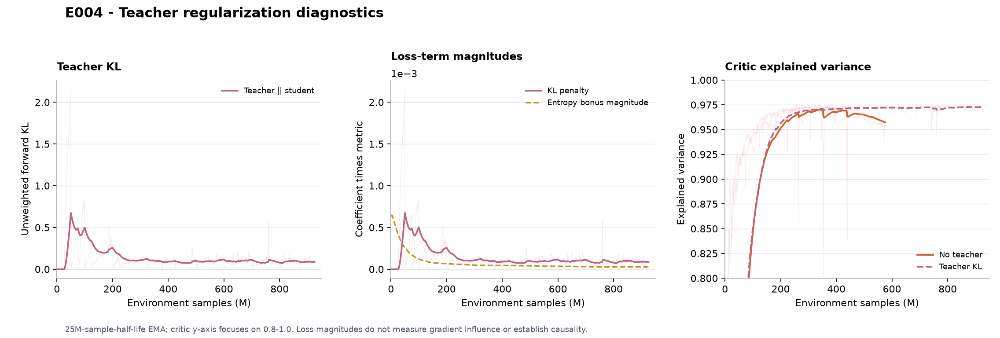

The small no-teacher run's entropy is about **0.0200** at its 275M peak and **0.0232** at 575M. Thus its late regression cannot be summarized as entropy simply decreasing to zero. At 575M, D has entropy about **0.0356**, value loss **0.120**, and critic explained variance **0.972**, compared with **0.0232 / 0.215 / 0.959** without a teacher. These are correlated diagnostic differences, not an identified causal chain. Teacher KL is separate from PPO approximate KL; loss-term magnitudes do not measure their gradient influence.

**Conclusion:** the entity base and teacher-regularized small trajectories exceed the MLP range in held-out eval. Base is the strongest observed architecture candidate at 400M; teacher KL is a promising retention direction for small. Complete-run stability and clean causal attribution remain unresolved.

## What to take forward

1. Use **large-batch, epoch-1** as the main MLP reference under the current LR; avoid assuming that rollout growth or more epochs will improve it.
2. Keep the **entity base** as a high-score candidate, but obtain a full-budget trajectory before calling its late performance stable. Its current history is incomplete.
3. If the next question is the isolated effect of teacher KL, compare matched initial training states and retain pre-KL trajectory checks. D is encouraging, but the current two runs cannot attribute all of the improvement to the regularizer.
4. At high average scores, log **per-episode eval scores and termination/truncation outcomes** if tail behavior matters. Current mean/std/min/max cannot recover a win rate or paired episode differences. D's last eval still includes a minimum score of 2 despite its 131.55 mean.

## Evidence, limits and reproduction

The export uses W&B **`scan_history(keys=None, use_cache=False)`**, rather than the sampled history used by charts. Configs, summaries, compressed full metric histories and a SHA-256 inventory are downloaded under **`analysis/wandb/raw/`** locally; raw archives are Git-ignored. This is a metric/config export, not a download of model checkpoints or all W&B artifacts. Portable reviewed data and figures are under [docs/analysis](docs/analysis/run-catalog.md). The [methods and validation record](docs/analysis/methods.md) defines calculations, scope, source links and checks.

The one-seed design is deliberate. The 1,024 evaluation games do not substitute for independent training repetitions, and the same eval seeds are reused for stopping and teacher selection. Evaluation is held out from PPO transitions, but it also acts as a validation set for those decisions; there is no fresh test-set confirmation of selected peaks. No confidence bands, significance claims or rliable training-seed uncertainty estimates are invented from these trajectories. These reporting choices follow the concerns discussed in [Empirical Design in Reinforcement Learning](https://arxiv.org/abs/2304.01315), [Deep Reinforcement Learning that Matters](https://arxiv.org/abs/1709.06560), and [Rliable's evaluation explanation](https://araffin.github.io/post/rliable/).

Reproduce the download and analysis using existing W&B credentials (do not place API keys in source files):

```powershell
# Export: the base Python has the W&B SDK.
& 'C:/Users/Liuluotu/Anaconda/anaconda3/python.exe' scripts/export_wandb_runs.py

# Analyze/render: orbit_wars has a compatible NumPy/pandas/Matplotlib stack.
& 'C:/Users/Liuluotu/Anaconda/anaconda3/envs/orbit_wars/python.exe' scripts/analyze_wandb_runs.py
& 'C:/Users/Liuluotu/Anaconda/anaconda3/envs/orbit_wars/python.exe' scripts/build_experiment_readme.py
```

`export_wandb_runs.py --refresh` fetches all histories again; by default unchanged, fully exported runs are cached. New runs require reviewing the conclusions as well as regenerating tables. The analysis verifies archive hashes, row counts, unique history steps, sample clocks, score bounds, summary coverage, optimizer-step accounting and D's teacher-update rule. An interrupted export does not create fabricated observations. If W&B requires a proxy, use the numeric proxy port in that command's environment; the scripts do not change system network settings.

## Run the current experiments

The active E004 configs are [A–D](config/experiments/feature_architecture). These are configs for new runs; historical W&B identities remain as documented above. For example, start **D only**:

```powershell
$env:LIBTORCH = 'C:\Users\Liuluotu\Anaconda\anaconda3\envs\orbit_wars\Lib\site-packages\torch'
powershell -NoProfile -ExecutionPolicy Bypass -File scripts/sweep_feature_architecture.ps1 -StartAt D -Only
```

Change `D` to `B` or `C` to select small or base. The sweep protects existing `latest.ot` files; `-AllowExistingCheckpoints` permits a fresh rerun, not a resume. CUDA uses the installed **memory-efficient BF16 SDPA** backend; it is not compiled CUDA FlashAttention. Full feature layouts, architecture diagrams, inference instructions and Windows setup are in the [technical guide](docs/technical-guide.md).

```powershell
cargo fmt --all -- --check
cargo test --all-targets
```
