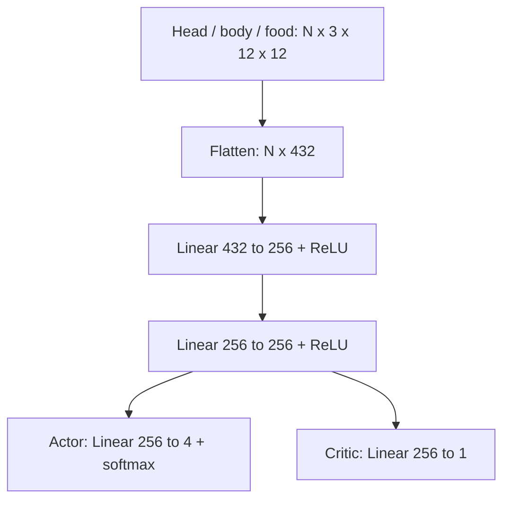
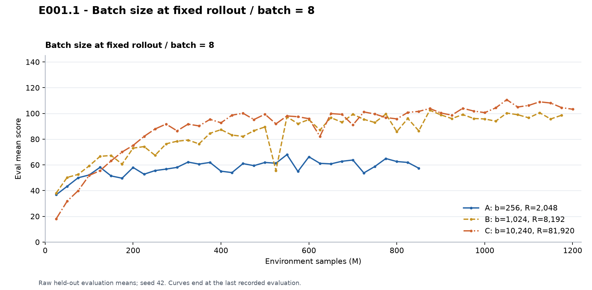
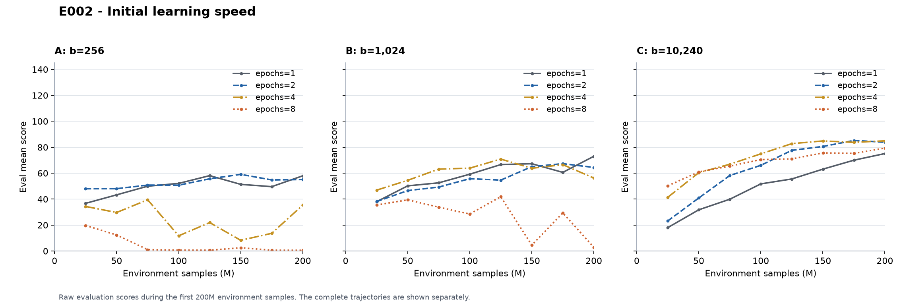
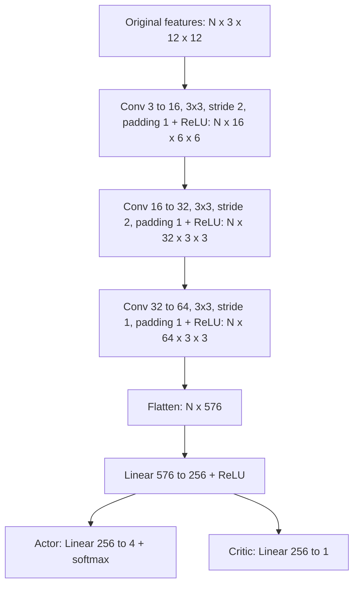
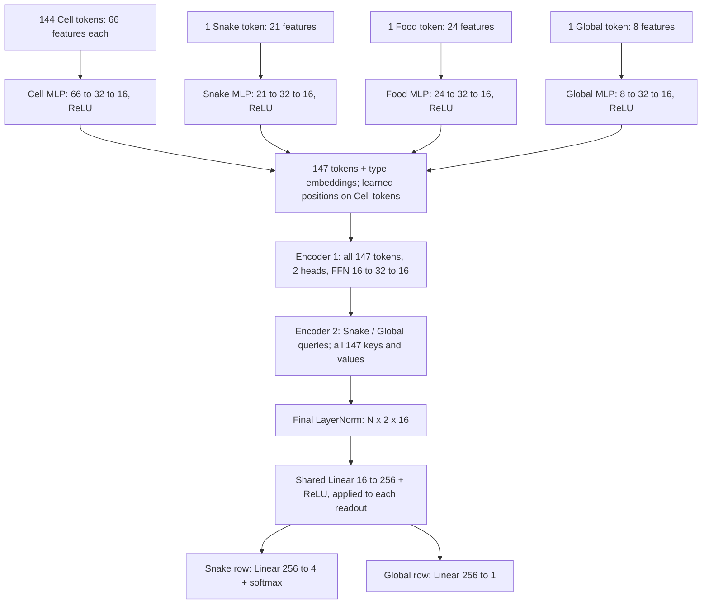
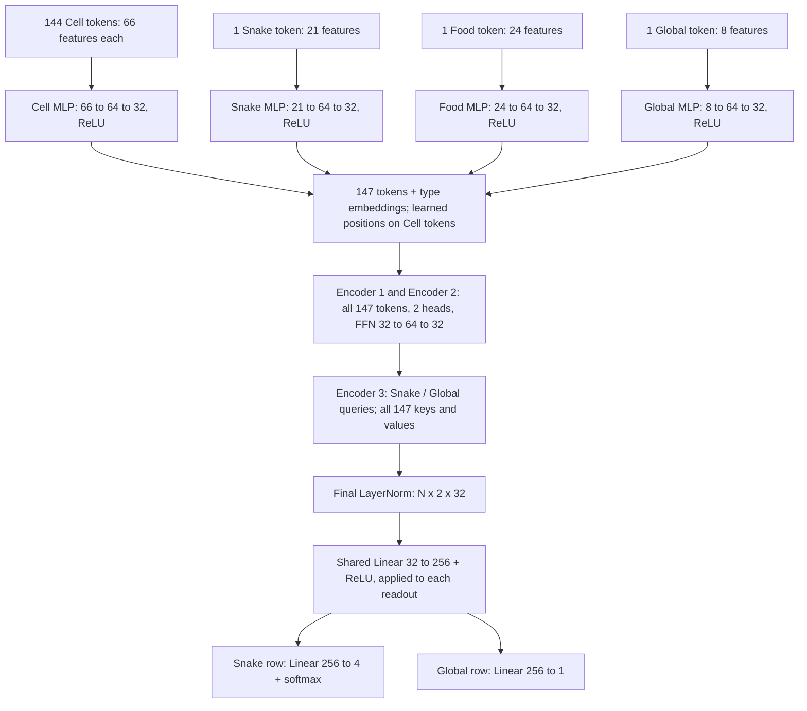
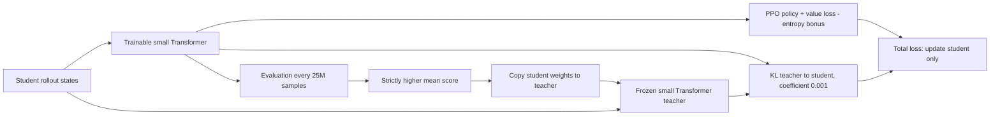

# PPO Snake: Reinforcement Learning Scaling Experiments

This project uses the classic **Snake game to study scaling laws in reinforcement learning**, including how **data, compute and model size** affect learning speed, score and training stability.

The board is **12×12**, the initial snake length is **3**, and the maximum score is **141**. Eating food gives reward 1; other transitions give reward 0.

## Main results

- **Larger batches achieve higher scores when rollout/batch stays at 8.** A/B/C use batches **256 / 1,024 / 10,240** and reach best scores of **67.94 / 102.48 / 110.65**. Rollout size and environment count grow proportionally with batch size.
- **Increasing rollout/batch at a fixed batch size does not consistently improve scores.** It helps batch 10,240 when the ratio grows from 2 to 8, but not batch 256 or 1,024 in the tested comparisons.
- **More PPO epochs can learn faster initially, but hurt later scores.** The early speedup is clearest at batch 10,240. Small batches suffer much more from repeated updates; eight epochs causes severe degradation at batch 256 and 1,024.
- **Switching to a larger batch does not generally recover the score of starting with that batch.** A→B and A→C stay lower, while B-500M→C almost catches up. Early, middle and late switches produce different outcomes.
- **Transformer models with richer features score much higher than the baseline MLP.** The small entity Transformer reaches **125.55**; increasing model size raises this to **132.94** and speeds up learning.
- **Teacher KL improves score retention.** Small + teacher KL avoids the sustained late collapse of the no-teacher small run and finishes its recorded trajectory at **131.55**, compared with **71.62** without a teacher.

| Experiment | Content | Model |
| --- | --- | --- |
| [E001.1](#e001-batch) | Batch size, keeping rollout/batch = 8 | Baseline MLP |
| [E001.2](#e001-rollout) | Rollout/batch ratio, keeping batch size fixed | Baseline MLP |
| [E002](#e002) | PPO epochs | Baseline MLP |
| [E003](#e003) | Switch the complete batch/rollout scale during training | Baseline MLP |
| [E004](#e004) | Features, architecture, model size and teacher KL | CNN and Transformer variants |

## Shared configuration

**Both E001 experiments, E002 and E003 use the same baseline MLP and the same three input planes.** E004 fixes the large batch/rollout configuration and changes the features, architecture, model size or teacher loss. E001.1 and E001.2 reuse the original six E001 runs; the A–F run labels are unchanged.

| Parameter | E001.1 / E001.2 | E002: epochs | E003: switching | E004: features / architecture |
| --- | --- | --- | --- | --- |
| Model | MLP 432→256→256 | Same MLP | Same MLP | CNN / Transformer variants |
| Input features | Head, body, food | Same 3 planes | Same 3 planes | 3 planes or 66/21/24/8 entity features |
| Mini-batch `b` | 256 / 1,024 / 10,240 | A/B/C: 256 / 1,024 / 10,240 | Switch between A/B/C | **10,240** |
| Rollout `R` | 2,048 / 8,192 / 20,480 / 81,920 | A/B/C: 2,048 / 8,192 / 81,920 | Switch together with `b`, keeping `R/b=8` | **81,920** |
| Parallel environments | 32 / 128 / 320 / 1,280 | 32 / 128 / 1,280 | Switch together with `b` | **1,280** |
| Rollout steps per environment | 64 | 64 | 64 | 64 |
| PPO epochs | **1** | **1 / 2 / 4 / 8** | **1** | **1** |
| Initialization | From scratch | From scratch | Existing checkpoint; Adam reset | From scratch |
| Device | CPU | CPU | CPU | CNN: CPU; Transformers: CUDA |
| Teacher KL coefficient | 0 | 0 | 0 | 0 except **D: 0.001** |
| Maximum new samples | 1,200M | 1,200M | 1,200M **after the switch** | 1,200M |

| Shared parameter | Value |
| --- | --- |
| Board / initial snake length | 12×12 / 3 |
| Training seed | 42 |
| Optimizer / learning rate | Adam / **0.0003**, fixed |
| Discount `gamma` | 0.99 |
| GAE `lambda` | 0.95 |
| PPO clip range | 0.2 |
| Value loss coefficient | 1.0 |
| Entropy coefficient | 0.001 |
| Gradient clipping threshold | 0.5 |
| Evaluation | Every **25M** samples; **1,024** fixed-seed games; deterministic actions |
| Maximum evaluation episode length | 5,000 steps |
| Early stopping | **12** evaluations without a new best mean score |
| Training score window | Latest 1,024 completed games |
| Checkpoint interval | 50M samples |

**Scores in the result tables are evaluation mean scores.** `M` means one million environment transitions. “Best” is the highest recorded evaluation; “last” is the last recorded evaluation; “last 4 evals” averages the final four points. Evaluation curves are unsmoothed. Training-diagnostic plots use the EMA half-life stated in each figure.

## Baseline model and input features

The batch, rollout, epoch and switching experiments use **`mlp_v1`**, with **177,925 parameters**. Its two shared hidden layers feed an actor with four absolute actions—up, down, left and right—and a scalar value head.

### Baseline features

Each feature is a 12×12 binary plane. The three planes are flattened into **432 values**.

| Channel | Feature | Encoding |
| --- | --- | --- |
| 0 | Snake head | 1 at the head cell, 0 elsewhere |
| 1 | Snake body | 1 on all body cells including the tail, excluding the head |
| 2 | Food | 1 at the food cell, 0 elsewhere |

### Baseline architecture



`N` is the number of states processed together. It is 1 for a single game and larger during parallel sampling, mini-batch training and batched evaluation.

<a id="e001"></a>
<a id="e001-batch"></a>

## E001.1 — Batch size at fixed rollout/batch

### Experiment contents

Compare **A, B and C** with mini-batch sizes **256, 1,024 and 10,240**, keeping **rollout/batch = 8**. Rollout size and the number of parallel environments increase proportionally; the per-environment rollout horizon stays at 64 steps.

### Key configuration

All three runs use the baseline MLP, original three-plane features, epoch 1 and learning rate 0.0003. Each rollout supplies **8 mini-batch optimizer steps**. This is the project's batch-scaling experiment: the fixed quantity is `R/b`, rather than the absolute rollout size.

| Run | Mini-batch b | Rollout R | Environments | R/b |
| --- | --- | --- | --- | --- |
| A | 256 | 2,048 | 32 | 8 |
| B | 1,024 | 8,192 | 128 | 8 |
| C | 10,240 | 81,920 | 1,280 | 8 |

### Model architecture


### Results

| Run | Eval @300M | Eval @600M | Best score | Last score | Last 4 evals | Training M |
| --- | --- | --- | --- | --- | --- | --- |
| A | 58.03 | 66.26 | 67.94 | 57.39 | 61.69 | 850 |
| B | 78.38 | 95.23 | 102.48 | 98.56 | 97.82 | 1175 |
| C | 86.44 | 95.87 | 110.65 | 103.24 | 106.19 | 1200 |




### Analysis

1. **Batch 256 has a much lower score range.** At 600M samples, A scores **66.26**, compared with **95.23** for B and **95.87** for C.
2. **The largest batch achieves the highest later scores.** B and C are close at 600M, but their best scores are **102.48 and 110.65**. The means of their last four evals are **97.82 and 106.19**, compared with **61.69** for A. These tail windows occur at different training endpoints, as the table shows.
3. **Larger batches have lower value loss and slower entropy decay.** During 500–600M, A/B/C have average value losses of approximately **0.154 / 0.109 / 0.090**, entropy of **0.0186 / 0.0229 / 0.0345**, and raw advantage std of **0.398 / 0.332 / 0.300**.

The comparison measures scaling batch and rollout together at a fixed ratio. It does not separate their individual contributions. At epoch 1, all runs still use each collected transition once, while larger batches reduce the number of optimizer steps per environment sample.

### Conclusion

**At rollout/batch = 8, increasing batch size raises the achieved score range, with batch 10,240 producing the highest observed scores.** The improvement from 1,024 to 10,240 is most visible later in training.

<a id="e001-rollout"></a>

## E001.2 — Rollout/batch ratio at fixed batch size

### Experiment contents

Keep PPO mini-batch size fixed and change **rollout/batch**: compare **A vs D** at batch 256 (**8 vs 32**), **B vs E** at batch 1,024 (**8 vs 80**), and **F vs C** at batch 10,240 (**2 vs 8**). Rollout size changes through the number of environments; the per-environment horizon remains 64.

### Key configuration

All runs use the baseline MLP, original three-plane features, epoch 1 and learning rate 0.0003. `R = number of environments × 64`. At epoch 1, `R/b` is also the number of mini-batch optimizer steps per rollout; increasing it does not increase how often each transition is reused.

| Run | Mini-batch b | Rollout R | Environments | R/b |
| --- | --- | --- | --- | --- |
| A | 256 | 2,048 | 32 | 8 |
| D | 256 | 8,192 | 128 | 32 |
| B | 1,024 | 8,192 | 128 | 8 |
| E | 1,024 | 81,920 | 1,280 | 80 |
| F | 10,240 | 20,480 | 320 | 2 |
| C | 10,240 | 81,920 | 1,280 | 8 |

### Model architecture


### Results

| Run | Eval @300M | Eval @600M | Best score | Last score | Last 4 evals | Training M |
| --- | --- | --- | --- | --- | --- | --- |
| A | 58.03 | 66.26 | 67.94 | 57.39 | 61.69 | 850 |
| D | 56.90 | 48.16 | 65.83 | 60.92 | 58.16 | 725 |
| B | 78.38 | 95.23 | 102.48 | 98.56 | 97.82 | 1175 |
| E | 62.82 | 77.06 | 101.03 | 98.21 | 84.71 | 1125 |
| F | 76.70 | 87.74 | 99.58 | 96.64 | 97.17 | 1200 |
| C | 86.44 | 95.87 | 110.65 | 103.24 | 106.19 | 1200 |


### Analysis

1. **At batch 256, increasing R/b from 8 to 32 does not improve the score.** Increasing R from 2,048 to 8,192 changes the best score from **67.94 to 65.83**. At 600M, ratio 8 scores **66.26**, versus **48.16** for ratio 32.
2. **At batch 1,024, increasing R/b from 8 to 80 slows learning.** At 600M, ratio 8 scores **95.23**, versus **77.06** for ratio 80. Their best scores are similar, **102.48 vs 101.03**.
3. **At batch 10,240, increasing R/b from 2 to 8 helps.** At the shared 1,200M endpoint, ratio 8 scores **103.24**, versus **96.64** for ratio 2. Their best scores are **110.65 vs 99.58**.

Rollout size determines how often a new policy collects fresh data. Here it also changes the number of parallel environments. Its effect depends on the mini-batch size rather than following a simple larger-is-better rule.

### Conclusion

**At a fixed batch size, a larger rollout/batch ratio is not always better.** Ratio 8 outperforms 32 at batch 256 and learns faster than 80 at batch 1,024, while increasing the ratio from 2 to 8 helps batch 10,240. Together with E001.1, this shows that simply increasing rollout at a fixed batch does not reproduce the gains from scaling batch and rollout proportionally.

<a id="e002"></a>

## E002 — PPO epochs

### Experiment contents

Reuse each rollout for **1, 2, 4 or 8 PPO epochs**. Compare how repeated updates affect initial learning speed, later score and collapse at different batch sizes.

### Key configuration

| Scale | Mini-batch b | Rollout R | Environments | Epochs | Learning rate | Model / features |
| --- | --- | --- | --- | --- | --- | --- |
| A | 256 | 2,048 | 32 | 1 / 2 / 4 / 8 | 0.0003 | Baseline MLP / 3 planes |
| B | 1,024 | 8,192 | 128 | 1 / 2 / 4 / 8 | 0.0003 | Baseline MLP / 3 planes |
| C | 10,240 | 81,920 | 1,280 | 1 / 2 / 4 / 8 | 0.0003 | Baseline MLP / 3 planes |

The epoch-1 runs are the A/B/C baselines from E001. All other settings stay the same.

### Model architecture


The network is unchanged. More epochs repeat optimization over the same rollout.

### Results



| Scale | Epochs | Score @25M | Score @50M | Score @100M |
| --- | --- | --- | --- | --- |
| A | 1 | 36.76 | 43.31 | 52.12 |
| A | 2 | 48.02 | 48.07 | 50.74 |
| A | 4 | 34.37 | 29.71 | 11.75 |
| A | 8 | 19.73 | 12.39 | 0.69 |
| B | 1 | 38.04 | 50.23 | 59.20 |
| B | 2 | 38.16 | 46.57 | 55.75 |
| B | 4 | 46.94 | 54.49 | 63.87 |
| B | 8 | 35.47 | 39.46 | 28.54 |
| C | 1 | 18.07 | 31.80 | 51.75 |
| C | 2 | 23.23 | 40.91 | 66.05 |
| C | 4 | 41.43 | 60.41 | 74.90 |
| C | 8 | 50.26 | 60.99 | 70.47 |


| Scale | Epochs | Score @300M | Best score | Last score | Last 4 evals | Training M |
| --- | --- | --- | --- | --- | --- | --- |
| A | 1 | 58.03 | 67.94 | 57.39 | 61.69 | 850 |
| A | 2 | 61.98 | 62.08 | 35.25 | 31.49 | 825 |
| A | 4 | 15.64 | 39.50 | 19.14 | 11.96 | 375 |
| A | 8 | 1.84 | 19.73 | 1.15 | 1.74 | 325 |
| B | 1 | 78.38 | 102.48 | 98.56 | 97.82 | 1175 |
| B | 2 | 69.05 | 71.57 | 69.12 | 68.99 | 575 |
| B | 4 | 54.60 | 70.87 | 62.68 | 64.01 | 425 |
| B | 8 | 17.29 | 41.85 | 1.06 | 2.96 | 425 |
| C | 1 | 86.44 | 110.65 | 103.24 | 106.19 | 1200 |
| C | 2 | 88.44 | 107.92 | 107.87 | 105.63 | 1200 |
| C | 4 | 88.97 | 107.13 | 103.44 | 104.35 | 1200 |
| C | 8 | 83.22 | 95.14 | 57.95 | 51.22 | 1000 |

### Analysis

**Initial learning can be faster with more epochs.** At batch 10,240 and 50M samples, epoch 1/2/4/8 scores are **31.80 / 40.91 / 60.41 / 60.99**. At 100M, they are **51.75 / 66.05 / 74.90 / 70.47**. The effect also appears with selected moderate increases at smaller scales: A with epoch 2 scores **48.02** at 25M versus **36.76** with epoch 1; B with epoch 4 scores **54.49** at 50M versus **50.23** with epoch 1. Eight epochs is already too much for A/B early in training.

**More epochs hurt later scores, especially at small batch sizes.** A's last-four scores for epoch 1/2/4/8 are **61.69 / 31.49 / 11.96 / 1.74**. B's are **97.82 / 68.99 / 64.01 / 2.96**. C is much less affected by epochs 2–4: **106.19 / 105.63 / 104.35** for epochs 1/2/4, although epoch 8 still drops to **51.22**.


A's epoch-2 run illustrates the later instability: eval falls from **48.03 at 700M** to **13.99 at 750M**, before partially recovering. Training scores fall too; raw advantages fluctuate and critic explained variance deteriorates. More epochs apply more updates before fresh data arrives, and the fixed learning rate makes the cumulative policy change larger. These are plausible contributors to the degradation visible in the curves.

### Conclusion

**Additional epochs trade faster initial learning for lower later scores and more instability. The smaller the batch, the stronger the damage.** Batch 10,240 tolerates 2–4 epochs relatively well, but still does not improve the late average over epoch 1. Eight epochs degrades all three scales. Epoch 1 remains the best overall choice in this experiment.

<a id="e003"></a>

## E003 — Switching batch and rollout during training

### Experiment contents

Start from an A/B/C checkpoint and switch the complete training scale. Test whether a policy trained with a smaller batch can catch up after switching upward, and whether a policy trained with a larger batch keeps its strength after switching downward. Then compare early, middle and late switches for each source curve.

### Key configuration

| Direction | Source b / R | Target b / R | Switch points | Model | Optimizer on switch |
| --- | --- | --- | --- | --- | --- |
| A→B | 256 / 2,048 | 1,024 / 8,192 | 100 / 300 / 550M | Baseline MLP | Reset Adam |
| A→C | 256 / 2,048 | 10,240 / 81,920 | 100 / 300 / 550M | Baseline MLP | Reset Adam |
| B→C | 1,024 / 8,192 | 10,240 / 81,920 | 200 / 500 / 850M | Baseline MLP | Reset Adam |
| C→B | 10,240 / 81,920 | 1,024 / 8,192 | 150 / 450 / 850M | Baseline MLP | Reset Adam |

Rollout horizon stays at 64 and R/b stays at 8. The model weights are retained; features, learning rate and epoch 1 are unchanged. Each branch can train for up to **1,200M additional samples**, with the same eval-based early stopping.

### Model architecture


Only the batch/rollout scale changes. The MLP and its input features stay the same throughout the switch.

### Results

| Schedule | Score at switch | After +300M | Best score | Last score | Total / additional M |
| --- | --- | --- | --- | --- | --- |
| A-100M-to-B | 52.12 | 67.61 | 70.17 | 67.91 | 975 / 875 |
| A-100M-to-C | 52.12 | 68.30 | 83.95 | 83.95 | 1300 / 1200 |
| A-300M-to-B | 58.03 | 60.13 | 69.54 | 69.10 | 825 / 525 |
| A-300M-to-C | 58.03 | 69.71 | 98.46 | 93.87 | 1500 / 1200 |
| A-550M-to-B | 67.94 | 71.32 | 72.22 | 72.07 | 1700 / 1150 |
| A-550M-to-C | 67.94 | 72.22 | 77.98 | 75.60 | 1750 / 1200 |
| B-200M-to-C | 73.01 | 84.06 | 101.61 | 97.71 | 1400 / 1200 |
| B-500M-to-C | 89.45 | 100.25 | 110.61 | 108.12 | 1700 / 1200 |
| B-850M-to-C | 86.43 | 106.37 | 107.42 | 106.01 | 1325 / 475 |
| C-150M-to-B | 63.12 | 97.18 | 98.32 | 97.53 | 625 / 475 |
| C-450M-to-B | 100.13 | 93.82 | 100.13 | 93.82 | 750 / 300 |
| C-850M-to-B | 101.57 | 102.06 | 108.28 | 105.31 | 1700 / 850 |


The total-sample plot includes pretraining. The additional-sample plot starts at each switch and shows adaptation speed.

### Analysis

**First, compare switching with training from scratch.** The upward switches do not exceed the best scores of starting with the target batch: A→B peaks around **70–72**, below B's **102.48**; A→C peaks around **78–98**, below C's **110.65**. B-500M→C comes very close at **110.61**. The downward C-850M→B branch reaches **108.28**, retaining more strength than B-from-scratch's peak of 102.48, although remaining below the original C peak. Thus the weak A-trained policies do not fully catch up, while a strong large-batch policy can retain much of its strength at a smaller batch.

| Direction | Early switch | Middle switch | Late switch | Timing result |
| --- | --- | --- | --- | --- |
| A→B | Last score **67.91** | **69.10** | **72.07** | Later switches finish slightly higher, but all remain far below B from scratch |
| A→C | **83.95** | **93.87** | **75.60** | Middle is best; the late switch recovers least |
| B→C | **97.71** | **108.12** | **106.01** | Middle and late are stronger than early; middle almost matches C's best score |
| C→B | **97.53** | **93.82** | **105.31** | Late best preserves the stronger source policy |

Switching earlier is therefore not always better. For A→C, the 550M switch stays near the original small-batch score range even after a long continuation. For B→C, more developed source policies transfer better. For C→B, the late checkpoint preserves high scores, while the 450M checkpoint never beats its initial **100.13** and finishes at **93.82**. Branches have different training lengths, shown in the result table, so the timing comparison describes their recorded trajectories.

### Conclusion

**Increasing batch size partway through training does not automatically recover the score of using the larger batch from the beginning.** Recovery depends on the source policy and switch time. Very small-batch pretraining leaves a larger gap; medium-batch pretraining can nearly catch up. A strong large-batch policy can also keep a high score after the batch is reduced. There is no single early-or-late switching rule across all four directions.

<a id="e004"></a>

## E004 — Features, model architecture and teacher KL

### Experiment contents

Keep the strongest E001 training scale fixed and change the representation and network. Compare the original-feature CNN, the small entity Transformer, the larger entity Transformer, and the small entity Transformer with a best-eval teacher KL loss.

### Key configuration

All E004 runs use **batch 10,240**, **rollout 81,920**, **1,280 environments**, **64 rollout steps**, **epoch 1**, **learning rate 0.0003**, **entropy coefficient 0.001**, and a **256-unit output projection**. Only D adds teacher KL with coefficient 0.001.

| Run | Model | Raw features | Input projection | Depth | Token dim | Parameters | Teacher KL |
| --- | --- | --- | --- | --- | --- | --- | --- |
| A | CNN | 3 planes | — | 3 convolutions | — | 172,581 | 0 |
| B | Entity Transformer small | 66 / 21 / 24 / 8 | input → 32 → 16 | 2 | 16 | 18,533 | 0 |
| C | Entity Transformer base | 66 / 21 / 24 / 8 | input → 64 → 32 | 3 | 32 | 56,357 | 0 |
| D | Small + teacher KL | 66 / 21 / 24 / 8 | input → 32 → 16 | 2 | 16 | 18,533 per model | 0.001 |

### Model architectures

#### A — CNN with original features

Input features are the same head/body/food planes used by the baseline MLP. All convolutions use zero padding of width 1.



#### B — Small entity Transformer

The board contributes **144 Cell tokens**, followed by **1 Snake, 1 Food and 1 Global token**, for **147 tokens**. Four independent input MLPs embed the token types. The actor reads Snake and the critic reads Global.



#### C — Larger entity Transformer

C uses the same features as small, but expands the input MLP from **input→32→16** to **input→64→32**, the token dimension from **16 to 32**, and the encoder depth from **2 to 3**.



Both entity models use pre-LayerNorm encoders, 2 attention heads, residual connections, GELU FFNs with width `2 × token_dim`, no dropout and no attention mask. Intermediate layers update all tokens; the final layer produces only the Snake and Global query rows while attending to all 147 tokens.

#### D — Small entity Transformer with a teacher

The student backbone is exactly the small model above. A second, frozen small model supplies the teacher action distribution on student rollout states.



`Total loss = PPO loss + 0.001 × KL(teacher || student)`.

The first evaluation initializes the teacher. Whenever a later evaluation gets a higher mean score, the student weights replace the teacher; otherwise the teacher stays unchanged. Only the student is trained. Teacher updates do not reset the student or Adam. The coefficient is configurable through `teacher_kl.coef`.

### Entity input features

Small, base and D share the following features. The flat observation has **9,557 values**: `144 × 66 + 21 + 24 + 8`. Each context vector occurs once, rather than being repeated across the grid.

| Token | Number of tokens | Features per token | Role |
| --- | --- | --- | --- |
| Cell | 144 | 66 | Occupancy, body order, position, chain links and connected region |
| Snake | 1 | 21 | Snake length, heading, head position and available region |
| Food | 1 | 24 | Food position and its connected region |
| Global | 1 | 8 | Board occupancy and number of connected regions; critic readout |

For the tables below, `A=144`, `L` is snake length, and the body is indexed from the head. Release time `t=L-i` gives tail=1 and head=L, assuming no further growth. Ego coordinates `(dx′,dy′)` are relative to the head and rotated so the current heading points up. A region is a four-neighbor connected component of free cells, food and the current tail cell; the head and other body cells are blocked. `s` is the cell's region size, `h` the largest head-adjacent region, and `K` the number of regions.

#### Cell token — all 66 features

| Index | Feature | Encoding |
| --- | --- | --- |
| 0 | Snake head | 0/1 |
| 1 | Ordinary body (excluding head and tail) | 0/1 |
| 2 | Food | 0/1 |
| 3 | Empty cell | 0/1 |
| 4 | Snake tail | 0/1 |
| 5 | Normalized release time | t / A |
| 6 | Release in exactly 1 steps | 1 if t=1, else 0 |
| 7 | Release in exactly 2 steps | 1 if t=2, else 0 |
| 8 | Release in exactly 3 steps | 1 if t=3, else 0 |
| 9 | Release in exactly 4 steps | 1 if t=4, else 0 |
| 10 | Release in exactly 5 steps | 1 if t=5, else 0 |
| 11 | Release in exactly 6 steps | 1 if t=6, else 0 |
| 12 | Release in exactly 7 steps | 1 if t=7, else 0 |
| 13 | Release in exactly 8 steps | 1 if t=8, else 0 |
| 14 | Release in exactly 9 steps | 1 if t=9, else 0 |
| 15 | Release in exactly 10 steps | 1 if t=10, else 0 |
| 16 | Release in exactly 11 steps | 1 if t=11, else 0 |
| 17 | Release in exactly 12 steps | 1 if t=12, else 0 |
| 18 | Release in exactly 13 steps | 1 if t=13, else 0 |
| 19 | Release in exactly 14 steps | 1 if t=14, else 0 |
| 20 | Release in exactly 15 steps | 1 if t=15, else 0 |
| 21 | Release in exactly 16 steps | 1 if t=16, else 0 |
| 22 | Release later than 16 steps | 1 if t>16, else 0 |
| 23 | Log-release node 1 | Log-space two-hot weight |
| 24 | Log-release node 2 | Log-space two-hot weight |
| 25 | Log-release node 4 | Log-space two-hot weight |
| 26 | Log-release node 8 | Log-space two-hot weight |
| 27 | Log-release node 16 | Log-space two-hot weight |
| 28 | Log-release node 32 | Log-space two-hot weight |
| 29 | Log-release node 64 | Log-space two-hot weight |
| 30 | Log-release node 128 | Log-space two-hot weight |
| 31 | Log-release node 144 | Log-space two-hot weight |
| 32 | Absolute x | x / 11 |
| 33 | Absolute y | y / 11 |
| 34 | Ego x | dx′ / 11 |
| 35 | Ego y | dy′ / 11 |
| 36 | Ego x sin, frequency 1 | sin(π × 1 × dx′ / 12) |
| 37 | Ego x cos, frequency 1 | cos(π × 1 × dx′ / 12) |
| 38 | Ego y sin, frequency 1 | sin(π × 1 × dy′ / 12) |
| 39 | Ego y cos, frequency 1 | cos(π × 1 × dy′ / 12) |
| 40 | Ego x sin, frequency 2 | sin(π × 2 × dx′ / 12) |
| 41 | Ego x cos, frequency 2 | cos(π × 2 × dx′ / 12) |
| 42 | Ego y sin, frequency 2 | sin(π × 2 × dy′ / 12) |
| 43 | Ego y cos, frequency 2 | cos(π × 2 × dy′ / 12) |
| 44 | Ego x sin, frequency 4 | sin(π × 4 × dx′ / 12) |
| 45 | Ego x cos, frequency 4 | cos(π × 4 × dx′ / 12) |
| 46 | Ego y sin, frequency 4 | sin(π × 4 × dy′ / 12) |
| 47 | Ego y cos, frequency 4 | cos(π × 4 × dy′ / 12) |
| 48 | Ego x sin, frequency 8 | sin(π × 8 × dx′ / 12) |
| 49 | Ego x cos, frequency 8 | cos(π × 8 × dx′ / 12) |
| 50 | Ego y sin, frequency 8 | sin(π × 8 × dy′ / 12) |
| 51 | Ego y cos, frequency 8 | cos(π × 8 × dy′ / 12) |
| 52 | Link toward head: ego up | 0/1; zero when link is absent |
| 53 | Link toward head: ego down | 0/1; zero when link is absent |
| 54 | Link toward head: ego left | 0/1; zero when link is absent |
| 55 | Link toward head: ego right | 0/1; zero when link is absent |
| 56 | Link toward tail: ego up | 0/1; zero when link is absent |
| 57 | Link toward tail: ego down | 0/1; zero when link is absent |
| 58 | Link toward tail: ego left | 0/1; zero when link is absent |
| 59 | Link toward tail: ego right | 0/1; zero when link is absent |
| 60 | Region size | s / A |
| 61 | Log region size | log(1+s) / log(1+A) |
| 62 | Region size / snake length | min(s/L, 2) |
| 63 | Region size >= snake length | 1 if s>=L, else 0 |
| 64 | Region adjacent to tail | 0/1 |
| 65 | Region adjacent to head | 0/1 |

The release-time fields are zero on non-snake cells. Missing chain links and region fields on blocked cells are zero. Region adjacency means that the component contains a passable cell next to the head or tail. The region features describe the current board, not a future path through a moving snake.

#### Snake token — all 21 features

| Index | Feature | Encoding |
| --- | --- | --- |
| 0 | Normalized snake length | L / A |
| 1 | Log snake length | log(L) / log(A) |
| 2 | Length node 3 | Linear two-hot weight |
| 3 | Length node 5 | Linear two-hot weight |
| 4 | Length node 10 | Linear two-hot weight |
| 5 | Length node 20 | Linear two-hot weight |
| 6 | Length node 40 | Linear two-hot weight |
| 7 | Length node 60 | Linear two-hot weight |
| 8 | Length node 90 | Linear two-hot weight |
| 9 | Length node 120 | Linear two-hot weight |
| 10 | Length node 144 | Linear two-hot weight |
| 11 | Remaining free cells | (A-L) / A |
| 12 | Log remaining free cells | log(1+A-L) / log(1+A) |
| 13 | Absolute heading: up | 0/1 |
| 14 | Absolute heading: down | 0/1 |
| 15 | Absolute heading: left | 0/1 |
| 16 | Absolute heading: right | 0/1 |
| 17 | Head absolute x | head_x / 11 |
| 18 | Head absolute y | head_y / 11 |
| 19 | Largest head-adjacent region | h / A |
| 20 | Largest head-adjacent region / length | min(h/L, 2) |

#### Food token — all 24 features

| Index | Feature | Encoding |
| --- | --- | --- |
| 0 | Food exists | 0/1 |
| 1 | Food absolute x | food_x / 11 |
| 2 | Food absolute y | food_y / 11 |
| 3 | Food ego x | dx′ / 11 |
| 4 | Food ego y | dy′ / 11 |
| 5 | Ego x sin, frequency 1 | sin(π × 1 × dx′ / 12) |
| 6 | Ego x cos, frequency 1 | cos(π × 1 × dx′ / 12) |
| 7 | Ego y sin, frequency 1 | sin(π × 1 × dy′ / 12) |
| 8 | Ego y cos, frequency 1 | cos(π × 1 × dy′ / 12) |
| 9 | Ego x sin, frequency 2 | sin(π × 2 × dx′ / 12) |
| 10 | Ego x cos, frequency 2 | cos(π × 2 × dx′ / 12) |
| 11 | Ego y sin, frequency 2 | sin(π × 2 × dy′ / 12) |
| 12 | Ego y cos, frequency 2 | cos(π × 2 × dy′ / 12) |
| 13 | Ego x sin, frequency 4 | sin(π × 4 × dx′ / 12) |
| 14 | Ego x cos, frequency 4 | cos(π × 4 × dx′ / 12) |
| 15 | Ego y sin, frequency 4 | sin(π × 4 × dy′ / 12) |
| 16 | Ego y cos, frequency 4 | cos(π × 4 × dy′ / 12) |
| 17 | Ego x sin, frequency 8 | sin(π × 8 × dx′ / 12) |
| 18 | Ego x cos, frequency 8 | cos(π × 8 × dx′ / 12) |
| 19 | Ego y sin, frequency 8 | sin(π × 8 × dy′ / 12) |
| 20 | Ego y cos, frequency 8 | cos(π × 8 × dy′ / 12) |
| 21 | Food-region size | s_food / A |
| 22 | Food-region size / length | min(s_food/L, 2) |
| 23 | Food region adjacent to head | 0/1 |

All Food features are zero when there is no food.

#### Global token — all 8 features

| Index | Feature | Encoding |
| --- | --- | --- |
| 0 | Normalized snake length | L / A |
| 1 | Remaining free cells | (A-L) / A |
| 2 | Log remaining free cells | log(1+A-L) / log(1+A) |
| 3 | Exactly 1 connected regions | 1 if K=1, else 0 |
| 4 | Exactly 2 connected regions | 1 if K=2, else 0 |
| 5 | Exactly 3 connected regions | 1 if K=3, else 0 |
| 6 | Exactly 4 connected regions | 1 if K=4, else 0 |
| 7 | At least 5 connected regions | 1 if K>=5, else 0 |

### Results

| Run | Score @300M | Best score | Last score | Last 4 evals | Training / last-eval M |
| --- | --- | --- | --- | --- | --- |
| A | 51.06 | 75.23 | 74.42 | 72.49 | 1200 / 1200 |
| B | 104.33 | 125.55 | 71.62 | 82.44 | 575 / 575 |
| C | 121.10 | 132.94 | 132.94 | 130.21 | 419 / 400 |
| D | 109.01 | 131.90 | 131.55 | 125.65 | 925 / 925 |


At matching sample counts:

| Model | Score @300M | Score @400M | Score @575M |
| --- | --- | --- | --- |
| Baseline MLP | 86.44 | 92.71 | 97.42 |
| Small | 104.33 | 100.17 | 71.62 |
| Base | 121.10 | 132.94 | — |
| Small + teacher KL | 109.01 | 115.61 | 120.82 |


### Analysis

**Replacing the MLP with the tested CNN does not help.** With the original three input planes, CNN A reaches **75.23** and ends at **74.42**, below the MLP's best **110.65**.

**The richer entity representation and Transformer work much better.** Small reaches **125.55 at 275M**, exceeding the MLP's best score with far fewer samples. Its body-order, geometry, chain-link and connected-region features give the model explicit information about more than occupied cells.

**Increasing model size improves both speed and score.** Base reaches **125.12 at 125M**, while small is at **39.65** at the same point. At 400M, base scores **132.94** versus small's **100.17**. The larger token dimension, wider input MLP and extra encoder layer produce a much stronger result with the same input features.

**The no-teacher small model loses its high score later.** It falls from a peak of **125.55** to a last score of **71.62** at 575M. This is a sustained late regression rather than a single poor evaluation.

**Teacher KL substantially improves stability and the ending score.** At the same 575M point, D scores **120.82**, about **49.20** points higher than small without a teacher. D continues to 925M, reaches a best score of **131.90** and ends at **131.55**. Its curve has temporary drops, including **93.19 at 650M**, but recovers instead of showing the sustained late collapse seen without a teacher. The teacher acts as an anchor to previously successful behavior while the student continues learning.

The recorded base run has its last eval at 400M and training record at 419M. D's last eval is at 925M. Those are the endpoints shown here. Base also has sharp fluctuations in its late training-game scores, so high score and score retention remain separate properties.

### Conclusion

**Transformer + richer basic features improves the score; increasing the model size improves it further. Adding teacher KL makes the small model much more stable, prevents the sustained late collapse in this run, and produces a higher ending score.** These results motivate testing teacher KL on the larger entity model next.

## Running and reproducing the experiments

The current E004 configs are in [config/experiments/feature_architecture](config/experiments/feature_architecture). To run D only:

```powershell
$env:LIBTORCH = 'C:\Users\Liuluotu\Anaconda\anaconda3\envs\orbit_wars\Lib\site-packages\torch'
powershell -NoProfile -ExecutionPolicy Bypass -File scripts/sweep_feature_architecture.ps1 -StartAt D -Only
```

Change `D` to `B` or `C` for small or base. Existing checkpoints are protected by the sweep. `-AllowExistingCheckpoints` starts a fresh rerun rather than resuming it.

To regenerate the figures and README from the downloaded metric histories:

```powershell
& 'C:/Users/Liuluotu/Anaconda/anaconda3/envs/orbit_wars/python.exe' scripts/analyze_wandb_runs.py
& 'C:/Users/Liuluotu/Anaconda/anaconda3/envs/orbit_wars/python.exe' scripts/build_experiment_readme.py
```

Additional details: [per-run plots and results](docs/analysis/run-catalog.md), [result data](docs/analysis/data/run_results.csv), [technical guide](docs/technical-guide.md), and [metric definitions and calculation details](docs/analysis/methods.md).
