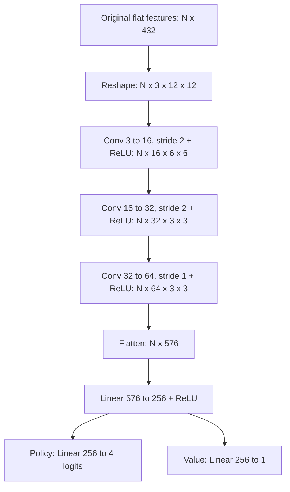
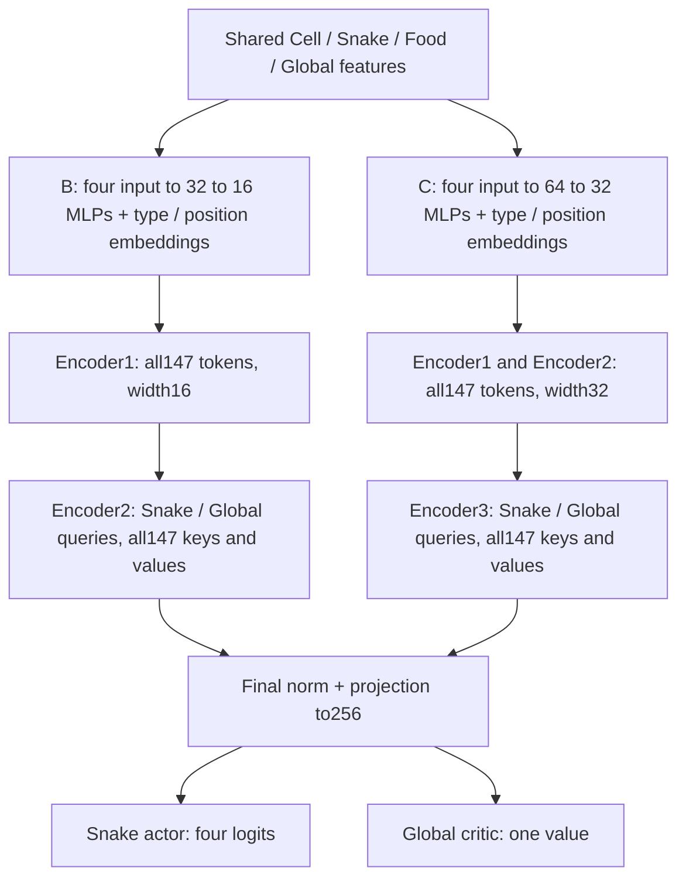

# PPO Snake (Rust)

This project uses a small Snake game to study scaling behavior in reinforcement learning without requiring high-end hardware. A 12×12 environment and compact PPO actor–critic make controlled CPU experiments practical. The experiments study PPO mini-batch size, rollout size, and the number of optimization epochs per rollout.

## E001: Batch and rollout scaling

All runs use training seed 42, 64 rollout steps per environment, a hidden size of 256, one PPO epoch, and a fixed learning rate of `3e-4`. Shared settings are `gamma=0.99`, `gae_lambda=0.95`, `clip_range=0.2`, `value_coef=1`, `entropy_coef=0.001`, and `max_grad_norm=0.5`. Each run has a **1,200M environment-sample cap** and the same early-stopping rule. All six runs have completed; result analysis is pending.

`R = num_envs × rollout_steps` is the amount collected for one PPO update; `b = ppo.batch_size` is the optimization mini-batch size.

| Group | Mini-batch `b` | Rollout `R` | Environments | `R/b` | Comparison |
| --- | ---: | ---: | ---: | ---: | --- |
| A | 256 | 2,048 | 32 | 8 | Small joint-scaling point; compare with D at fixed `b` |
| B | 1,024 | 8,192 | 128 | 8 | Middle joint-scaling point; compare with D at fixed `R` and E at fixed `b` |
| C | 10,240 | 81,920 | 1,280 | 8 | Large joint-scaling point; compare with E at fixed `R` and F at fixed `b` |
| D | 256 | 8,192 | 128 | 32 | Mini-batch effect versus B at `R=8,192` |
| E | 1,024 | 81,920 | 1,280 | 80 | Mini-batch effect versus C at `R=81,920` |
| F | 10,240 | 20,480 | 320 | 2 | Rollout effect versus C at `b=10,240` |

A–B–C repeat joint scaling at constant `R/b=8`. D–B and E–C vary mini-batch size while holding `R` fixed. A–D, B–E, and F–C vary `R` while holding mini-batch size fixed. With one PPO epoch, changing `b` also changes optimizer steps per environment sample; these comparisons describe the combined PPO mini-batch setting. Keep the learning rate and all other parameters fixed for this study.

## E002: PPO epoch scaling

Reuse completed E001 groups A, B, and C as the `epochs=1` baselines. Train nine new runs from scratch with `epochs=2,4,8`, changing only the epoch count and experiment identity relative to each corresponding baseline. The epoch-1 results remain in the E001 W&B group and are not rerun by the E002 sweep.

| Scale | Mini-batch `b` | Rollout `R` | Environments | Existing baseline | New configurations |
| --- | ---: | ---: | ---: | --- | --- |
| A | 256 | 2,048 | 32 | E001 A, epoch 1 | `A-ep2`, `A-ep4`, `A-ep8` |
| B | 1,024 | 8,192 | 128 | E001 B, epoch 1 | `B-ep2`, `B-ep4`, `B-ep8` |
| C | 10,240 | 81,920 | 1,280 | E001 C, epoch 1 | `C-ep2`, `C-ep4`, `C-ep8` |

All shared settings above, including the fixed learning rate, sample cap, evaluation seeds, 25M evaluation interval, 1,024 evaluation episodes, and patience of 12 evaluations, carry over to E002. Configurations are in [config/experiments/epoch_scale](config/experiments/epoch_scale). W&B uses group `E002 epoch scale` and run names such as `E002 epoch scale A-ep2`. Each run has its own checkpoint directory, for example `checkpoints/E002_epoch_scale_A-ep2/`.

An epoch makes one complete pass through the current rollout, with mini-batches reshuffled on each pass. Each scale has `R/b=8`, so epochs 1, 2, 4, and 8 perform 8, 16, 32, and 64 optimizer steps per rollout. At a fixed environment-sample budget, increasing epochs increases data reuse and optimization work. Compare evaluation mean score against environment samples for sample efficiency, and against wall time and optimizer steps for training cost. Compare epoch choices within each scale before comparing their effects across scales. Use common sampled milestones; do not extend stopped curves or treat an early stop as proof of a performance ceiling. Results describe training seed 42 under the fixed `3e-4` learning rate.

Preview, check the LibTorch runtime, and launch all nine new experiments:

```powershell
powershell -NoProfile -ExecutionPolicy Bypass -File scripts/sweep_epoch_scale.ps1 -DryRun
powershell -NoProfile -ExecutionPolicy Bypass -File scripts/sweep_epoch_scale.ps1 -CheckRuntime
powershell -NoProfile -ExecutionPolicy Bypass -File scripts/sweep_epoch_scale.ps1
```

The sweep builds once and runs `A-ep2`, `B-ep2`, `C-ep2`, then the three epoch-4 runs, then the three epoch-8 runs. It stops on failure and refuses to overwrite an existing selected run's `latest.ot`. To start at a particular experiment, run:

```powershell
powershell -NoProfile -ExecutionPolicy Bypass -File scripts/sweep_epoch_scale.ps1 -StartAt B-ep4
```

`-StartAt` launches that experiment and every subsequent experiment from scratch; it does not restore training state. Use `-AllowExistingCheckpoints` only for an intentional rerun that may overwrite checkpoints. To launch one experiment:

```powershell
cargo run --release -- --config config/experiments/epoch_scale/C-ep4.yaml
```

## E003: Batch/rollout switching from existing weights

This study tests whether models trained at smaller scales can recover after switching to a larger scale, and whether models trained at the largest scale retain their performance after switching down. A switch changes mini-batch size, rollout size, and environment count together, keeping `R/b=8`. It does not isolate mini-batch size alone.

Reuse nine E001 epoch-1 checkpoints and run **12 scale-switch branches**. All branches load the complete actor-critic weights and **reset Adam**, the training environments, random generators, rolling metrics, and early-stopping state. This is a weights-only warm start, not a restoration of the original training process.

| Source scale | Nominal source samples | Target scales per checkpoint | Branches |
| --- | --- | --- | ---: |
| A: `b=256`, `R=2,048`, 32 environments | 100M, 300M, 550M | B, C | 6 |
| B: `b=1,024`, `R=8,192`, 128 environments | 200M, 500M, 850M | C | 3 |
| C: `b=10,240`, `R=81,920`, 1,280 environments | 150M, 450M, 850M | B | 3 |

The stages describe the observed source curves, not guaranteed convergence. YAML files reference the actual checkpoint counts after full-rollout rounding; for example, nominal A-100M uses `samples-100001792.ot`, not an invented `samples-100000000.ot`. All nine source files must be copied into their original E001 checkpoint folders before running the complete sweep.

Every branch uses epoch 1, seed 42, fixed learning rate `3e-4`, and the corresponding target scale's E001 settings. Training ends through evaluation-based early stopping, with the original **1,200M additional-sample cap** retained as the maximum for each branch. There is no 300M training cap: approximately 300M is the waiting period without a new evaluation high. The early-stopping rule remains enabled: evaluate every 25M new samples on the same 1,024 held-out seeds, with patience 12. An extra evaluation before the first update establishes the branch's initial score and early-stopping best. No old best score or patience counter is inherited.

The optional training fields are:

```yaml
training:
  max_env_samples: 1200000000      # maximum new samples; early stopping can end sooner
  checkpoint_interval_samples: 50000000
  checkpoint_dir: checkpoints
  init_checkpoint: checkpoints/E001_batch_rollout_scale_exp-A/samples-100001792.ot
  pretrained_env_samples: 100001792
```

`total_samples = pretrained_env_samples + finetune_samples`. The extra `finetune_samples` W&B axis starts at zero; existing sample-axis charts default to cumulative `total_samples`. Select `finetune_samples` as a custom chart x-axis to compare adaptation after a switch. Evaluation, logging, checkpoint scheduling, optimizer-step counts, and wall time count only the new branch's work. Saved checkpoint filenames contain cumulative sample counts. Initialization files are read-only; the trainer rejects an output directory that contains the source checkpoint.

Configurations are in [config/experiments/batch_rollout_switch](config/experiments/batch_rollout_switch). W&B uses group `E003 batch rollout switch`, with names such as `E003 batch rollout switch A-100M-to-B`. Outputs use matching isolated folders such as `checkpoints/E003_batch_rollout_switch_A-100M-to-B/`.

Preview all 12 branches, check the runtime without training, and launch the sweep:

```powershell
powershell -NoProfile -ExecutionPolicy Bypass -File scripts/sweep_batch_rollout_switch.ps1 -DryRun
powershell -NoProfile -ExecutionPolicy Bypass -File scripts/sweep_batch_rollout_switch.ps1 -CheckRuntime
powershell -NoProfile -ExecutionPolicy Bypass -File scripts/sweep_batch_rollout_switch.ps1
```

Runs are ordered by source A/B/C, then early/middle/late. Run a subset or start at a particular branch:

```powershell
powershell -NoProfile -ExecutionPolicy Bypass -File scripts/sweep_batch_rollout_switch.ps1 -SourceGroup A -Stage Late
powershell -NoProfile -ExecutionPolicy Bypass -File scripts/sweep_batch_rollout_switch.ps1 -StartAt B-500M-to-C
cargo run --release -- --config config/experiments/batch_rollout_switch/A-550M-to-C.yaml
```

The sweep checks selected source files and existing output checkpoints before building. It stops if a branch fails. `-AllowExistingCheckpoints` permits an intentional fresh rerun that may overwrite E003 output files; it never resumes an interrupted branch. `-StartAt` applies after source/stage filtering and must name an included branch.

Compare switched branches against the original source- and target-scale baselines at the same cumulative sample count. There are no unchanged-scale restart controls; differences from the original baselines therefore combine the scale change with restarting the optimizer and training state. Plot adaptation against new samples, and report the last four evaluations as well as the complete curves. Compare with existing baselines only over their recorded sample ranges, without extrapolating stopped curves. An early stop does not establish irreversible damage. Conclusions are conditional on resetting Adam and the other training state.

## E004: Feature and model architecture experiments

The active configurations are **A, B, C and D** in [config/experiments/feature_architecture](config/experiments/feature_architecture). All train from scratch with batch **10,240**, PPO epoch **1**, rollout **81,920**, **1,280** environments, seed **42**, hidden readout size **256**, fixed LR **3e-4**, cap **1,200M**, evaluation every **25M** on **1,024** held-out episodes and patience **12**. B/C/D use CUDA and the same training, evaluation, logging and early-stop settings; D adds teacher KL regularization to B.

| Experiment | `model.version` | Features | Input MLPs | Encoders | Token width | Parameters on 12x12 |
| --- | --- | --- | --- | ---: | ---: | ---: |
| A | `cnn_v1` | Original head/body/food planes | CNN plus dense projection | - | - | 172,581 |
| B | `transformer_v1_small` | 66 Cell + 21 Snake + 24 Food + 8 Global | input -> 32 -> 16 | 2 | 16 | 18,533 |
| C | `transformer_v1_base` | Same as B | input -> 64 -> 32 | 3 | 32 | 56,357 |
| D | `transformer_v1_small` | Same as B; evaluation-best self-teacher KL | input -> 32 -> 16 | 2 | 16 | 18,533 per model |

One `model.version` selects both feature encoding and architecture. There is no separate feature-version setting. B versus C changes model capacity and depth while keeping inputs, reward, PPO and evaluation fixed. The retired names `transformer_v6` and `transformer_v7` are rejected, rather than accepted as compatibility aliases. Omitting a model version still selects the original MLP used by the earlier E001-E003 studies.

```yaml
model:
  version: transformer_v1_small
  hidden_size: 256
```

W&B uses group `E004 feature architecture` and run names `E004 feature architecture exp-A` through `exp-D`. Checkpoint folders use the corresponding names under `checkpoints/`, such as `checkpoints/E004_feature_architecture_exp-B/`. B's existing weights use the same tensor shapes under the new small name. C's base model has different shapes and starts independently in its own folder.

### D: Evaluation-best self-teacher KL

[D.yaml](config/experiments/feature_architecture/D.yaml) copies B's protocol and small Transformer, adding a fixed, independently configurable coefficient:

```yaml
teacher_kl:
  enabled: true
  coef: 0.001
```

Training uses `L = L_PPO + coef * mean_s KL(teacher(.|s) || student(.|s))`, on states collected by the student. This is the full action-distribution forward KL, including the teacher-entropy term, with no critic distillation. Teacher weights are frozen and stored independently; inference uses bounded mini-batches on the configured CUDA device. The coefficient does not decay and is independent of `ppo.entropy_coef`. Disabling the section, omitting it, or setting `coef: 0` skips teacher allocation/inference and retains ordinary PPO. Fixed-expert kickstarting and active self-teacher KL cannot be enabled together.

The first scheduled evaluation (at the rollout crossing 25M samples) copies the student into the teacher; no teacher penalty applies before that. At each later evaluation, a **strictly higher** held-out mean score replaces the teacher. A tie or lower score keeps the existing teacher and its recorded score. The same held-out evaluation seeds and deterministic evaluation protocol are used throughout. Updating the teacher never resets the student or Adam. Early stopping remains unchanged: 12 evaluations without a strict new high, with the existing 1,200M sample cap.

`latest.ot` and `samples-*.ot` remain student checkpoints. `teacher.ot` in D's run directory stores the most recently accepted teacher. W&B records `train_samples/teacher_kl_loss` (unweighted forward KL), `teacher_kl_coef` (effective coefficient), and `teacher_kl_penalty` (coefficient times KL), averaged over the upload's environment samples. Evaluation logs include `eval_samples/teacher_mean_score`, `teacher_source_samples`, and `teacher_updated` (1 on replacement, 0 otherwise). Before initialization, the effective coefficient is zero.

Launch D only from PowerShell:

```powershell
$env:LIBTORCH = 'C:\Users\Liuluotu\Anaconda\anaconda3\envs\orbit_wars\Lib\site-packages\torch'
powershell -NoProfile -ExecutionPolicy Bypass -File scripts/sweep_feature_architecture.ps1 -StartAt D -Only
```

The sweep discovers A-D automatically. Benchmark mode activates a frozen initial-student snapshot immediately to measure teacher overhead without waiting for 25M samples; it runs no evaluation and writes no formal checkpoints. This benchmark snapshot is identified in its JSON report.

### A: Original features with CNN

CNN v1 uses three 3x3 convolutions with padding 1, ReLU after each, followed by a 256-unit projection and the existing linear policy/value heads:



On the 12x12 board, CNN v1 has **172,581 parameters** versus **177,925** for the original MLP. This keeps parameter counts close, although compute costs and spatial structure differ. The final convolution's nominal receptive field is 15x15, and the dense projection combines all spatial positions. Dimensions are derived from the configured board size. There is no batch normalization, dropout, or change to the PPO optimizer/loss implementation.

The first configuration is [config/experiments/feature_architecture/A.yaml](config/experiments/feature_architecture/A.yaml). It logs to W&B group `E004 feature architecture`, run `E004 feature architecture exp-A`, with checkpoints in `checkpoints/E004_feature_architecture_exp-A/`. Load a CNN checkpoint with the same model version, board dimensions, and hidden size; existing MLP weights cannot initialize this different architecture.

### B and C: Cell, Snake, Food and Global tokens

Both Transformers use the same **147-token** sequence:

| Type | Count | Raw input dimensions | Role |
| --- | ---: | ---: | --- |
| Cell | 144 | 66 | Occupancy, geometry, body order and static topology |
| Snake | 1 | 21 | State-conditioned actor readout |
| Food | 1 | 24 | Explicit target and target-region information |
| Global | 1 | 8 | State-conditioned critic readout |

The flat observation contains **9,557 values**: 66 channel-major cell planes, followed by the three context vectors (21+24+8). Context vectors are not duplicated across cells or padded to 66 dimensions. Four independent ReLU input MLPs project the token types to the selected encoder width.

#### Cell feature layout

Let A=W*H and L be snake length. For head-first segment index i, release time t=L-i: tail=1, head=L. This is the earliest release time under **no future growth**, not a prediction of a cell staying free forever. Non-snake cells have all release features zero.

| Channels | Features | Encoding |
| --- | --- | --- |
| 0-4 | Head, ordinary body, food, empty, tail | Exclusive one-hot; ordinary body excludes both head and tail |
| 5 | Release time | t/A |
| 6-22 | Exact near-term release | t=1..16 one-hot, plus t>16 overflow |
| 23-31 | Logarithmic release two-hot | Interpolation in log-space between [1,2,4,8,16,32,64,128,144] on 12x12 |
| 32-33 | Absolute x, y | Divide by max(W-1,1), max(H-1,1) |
| 34-35 | Ego x, y | Head-centered coordinates, rotated so heading is up; divide by max(max(W,H)-1,1) |
| 36-51 | Ego Fourier position | For f=1,2,4,8: sin/cos(pi*f*dx'/max(W,H)), then sin/cos(pi*f*dy'/max(W,H)) |
| 52-55 | Link toward the head | Ego up/down/left/right one-hot |
| 56-59 | Link toward the tail | Ego up/down/left/right one-hot |
| 60-61 (B and C) | Region size | size/A, log(1+size)/log(1+A) |
| 62-63 (B and C) | Region size versus length | min(size/L,2), size>=L |
| 64-65 (B and C) | Tail/head adjacency | Region contains a passable cell adjacent to tail/head |

The ego frame rotates geometry and chain directions consistently. The action space remains four absolute directions; the Snake token's absolute heading provides the mapping. Learned absolute cell positions are retained, so the full network is not rotation-invariant. Missing links at the head/tail are zero.

For other board sizes, release nodes are the powers 1..128 strictly below A followed by A, with unused slots zero. This retains nine input slots and avoids duplicated or unsorted endpoints. Length nodes follow the analogous filtering rule below. A dimension of one has absolute coordinate zero; rectangular ego coordinates use the longer side for normalization.

Regions use a four-neighbor graph containing unoccupied cells (**including food**) and the **current tail cell**, blocking the head and remaining body. A single flood fill labels components. Blocked cells have zero region features. Tail/head adjacency means a region contains a cell one step from the respective endpoint; it does not mean the endpoint itself is an ordinary empty cell. These features are a static, optimistic tail-open snapshot: region size, connection to the tail and size>=L are **not safety guarantees**. Moving/growing bodies and newly formed loops can invalidate static reasoning. No time-aware BFS, articulation points, action masks or reward changes are included.

#### Context feature layouts

| Token | Indices | Features |
| --- | --- | --- |
| Snake | 0-1 | L/A, log(L)/log(A) |
| Snake | 2-10 | Linear two-hot on [3,5,10,20,40,60,90,120,144]; on other boards filter nodes below A, append A, pad unused slots |
| Snake | 11-12 | (A-L)/A, log(1+A-L)/log(1+A) |
| Snake | 13-16 | Absolute heading: up/down/left/right one-hot |
| Snake | 17-18 | Absolute head x/y |
| Snake | 19-20 | Largest head-adjacent component: size/A, min(size/L,2); zero if none |
| Food | 0 | Food exists; all Food features are zero if absent |
| Food | 1-2 | Absolute food x/y |
| Food | 3-20 | Food ego position and Fourier encoding, same 18 values as Cell channels 34-51 |
| Food | 21-23 | Food component size/A, min(size/L,2), head-adjacent flag |
| Global | 0-2 | L/A, (A-L)/A, log(1+A-L)/log(1+A) |
| Global | 3-7 | Component count 1..4 one-hot plus >=5; zero components gives all zero |

The environment has no starvation timer, training episode time limit or per-step penalty, so there are no hunger, food-age or remaining-time inputs. The evaluation-only 5,000-step cap is unchanged. The original three binary planes are **not** a compatible prefix: body/tail occupancy changed, and heterogeneous context follows the planes. Legacy teachers are rejected by config validation for these versions; The active B/C experiments do not use a teacher.

#### Network and execution

The small input MLP is Linear(input,32), ReLU, Linear(32,16), ReLU; the base MLP is Linear(input,64), ReLU, Linear(64,32), ReLU. Each model has four learned type embeddings and learned absolute cell positions. Both use two attention heads, pre-norm encoder blocks, GELU FFNs with width twice the embedding dimension, residuals, no dropout and no attention mask.

Small has two width-16 blocks (head dimension 8; FFN16->32->16); base has three width-32 blocks (head dimension 16; FFN32->64->32). Intermediate layers update all 147 tokens. Only the final layer evaluates the Snake and Global query rows against all 147 updated keys/values. Final LayerNorm and a shared embedding-width->256 ReLU projection precede the actor's four logits and critic's scalar value. Actor and critic read Snake and Global respectively.



CUDA parameters, projections and PPO remain FP32; attention Q/K/V use BF16 SDPA. The installed Windows runtime selects **memory-efficient SDPA**, not CUDA FlashAttention. Startup reports each layer's actual backend and query count: small147/2, base147/147/2. The code loads `torch_cuda.dll` before selecting CUDA. The project uses tch0.24 with the installed PyTorch/LibTorch2.11 CUDA runtime; the older 2.7 CPU libraries are incompatible.

#### Memory and feature computation

The FP32 rollout observations occupy about **2.92 GiB of host RAM** at R=81,920. PPO uploads only the current mini-batch (about **0.365 GiB of input observations** at batch10,240), avoiding a complete rollout copy on GPU. Activations, gradients, workspaces and allocator reservations require additional GPU memory.

For board area A, length L<=A and cell channel count C=66, body indexing is O(A+L), four-neighbor connected components are O(A), and filling the complete features is O(A*C). Flood fill runs once per state. Board-size-keyed thread-local tables cache coordinates, Fourier values, release/length expansions and logarithms. Components compute their attributes once; scratch buffers are reused, and independent environments encode into disjoint output slices in parallel. These optimizations preserve feature values and PPO update rules.

Reference short benchmarks on the RTX5070Ti Laptop used one warmup and two measured full rollouts at the actual batch/rollout size. The small architecture measured **37,826 collection samples/s** and **16,847 samples/s including bootstrap/PPO**, with sampled whole-device peak6,794MiB from baseline1,624MiB. The base architecture previously measured **31,765 / 13,598 samples/s**, with peak10,834MiB from baseline1,142MiB. Background usage differed, so these are not strictly paired measurements or a guaranteed speedup ratio. They exclude periodic evaluation/checkpointing and do not establish score performance.

The whole 66-channel CPU encoding measured approximately4.6-5.2 microseconds/state on fixed 12x12 fixtures after caching. To repeat the CPU-only benchmark:

```powershell
cargo run --release --example benchmark_features -- target/benchmarks/features.json 10000
```

BF16 parameter storage alone saves little for these small models. Full BF16 mixed precision could reduce activations but is not enabled; only attention already uses BF16. See the [PyTorch mixed precision documentation](https://docs.pytorch.org/docs/2.11/amp.html).

#### Launch and inference

Set the matching runtime, preview the active sweep, or launch a single configuration:

```powershell
$env:LIBTORCH = 'C:\Users\Liuluotu\Anaconda\anaconda3\envs\orbit_wars\Lib\site-packages\torch'
powershell -NoProfile -ExecutionPolicy Bypass -File scripts/sweep_feature_architecture.ps1 -DryRun
powershell -NoProfile -ExecutionPolicy Bypass -File scripts/sweep_feature_architecture.ps1 -StartAt B -Only
powershell -NoProfile -ExecutionPolicy Bypass -File scripts/sweep_feature_architecture.ps1 -StartAt C -Only
```

The sweep discovers A, B, C and D. Without `-Only`, starting at B runs B, C and D. It builds once and inspects actual configured checkpoint folders, refusing existing `latest.ot` unless `-AllowExistingCheckpoints` explicitly authorizes a fresh rerun. It does not resume training. Existing experiment checkpoints are not removed by changing the active study.

Benchmark a selected architecture without W&B or formal checkpoint writes:

```powershell
powershell -NoProfile -ExecutionPolicy Bypass -File scripts/sweep_feature_architecture.ps1 -StartAt C -Only -Benchmark -BenchmarkDevice cuda
```

Use the selected model version consistently for training, evaluation and visual inference. The existing [config/infer-B-v7.yaml](config/infer-B-v7.yaml) filename is retained for the user's playback command; its contents now select `transformer_v1_small`, with the selected snapshot under `checkpoints/E004_feature_architecture_exp-B/`. Edit its `inference.model_path` and `fps` to select a checkpoint and playback speed.

## Sample-based training and stopping

The YAML uses environment samples for the training cap, checkpoint interval, evaluation interval, and W&B upload interval. Early stopping counts evaluations. The outer PPO iteration remains an internal loop counter. A run can exceed its configured sample cap by less than one rollout `R`, because an update consumes a complete rollout.

All six ready-to-run configurations are in [config/experiments/batch_rollout](config/experiments/batch_rollout). Pass the desired experiment file explicitly. To launch group C:

```powershell
cargo run --release -- --config config/experiments/batch_rollout/C.yaml
```

Early stopping follows the deterministic evaluation mean score. Evaluation runs every **25M environment samples** on the same **1,024 held-out seeds**, starting at `seed + 1,000,003`; the training environments start at `seed` and use at most 1,280 distinct initial seeds in this study. Each new strict high resets the counter; **12 consecutive evaluations without a new high** stop training (approximately 300M further samples). The 1,200M sample cap remains the maximum. This rule is an experimental heuristic and may miss a later rebound; an early stop does not establish a performance ceiling.

Periodic and final checkpoints save `checkpoints/<safe_run_name>/samples-<total_samples>.ot` and `latest.ot` (for example, `checkpoints/E001_batch_rollout_scale_exp-C/latest.ot`). No checkpoint is selected as the best model. Evaluation uses 1,024 deterministic episodes with the same evaluation seeds at every checkpoint and across groups, capped at 5,000 steps per episode. Checkpoints are scheduled every 50M environment samples; evaluation is scheduled every 25M.

Evaluation uses the **same model and device as training** (CUDA for B/C). `evaluation.batch_size` defaults to **1,024** for old configurations and is explicit in B:

```yaml
evaluation:
  interval_samples: 25000000
  episodes: 1024
  batch_size: 1024
  deterministic: true
  max_steps_per_episode: 5000
```

All **1,024** held-out games start together. Each step encodes the active states into one observation batch, runs one GPU forward pass and copies the action vector to CPU once. Finished games leave the active batch and are never reset or counted twice; remaining games stop at their individual step limit. Thus **1,024** is the maximum inference batch size, which shrinks as episodes finish. If episodes exceed the configured batch size, subsequent cohorts cover the remaining episode IDs, including a partial final cohort. Every episode retains seed `seed + 1,000,003 + episode_index` and the same score/statistical weight. Training rollout/mini-batch sizes and early-stop criteria are unchanged. Periodic evaluation logs report the device and effective initial batch size. Batched floating-point kernels may change near-tied deterministic decisions; stochastic evaluation also changes random-draw ordering compared with serial evaluation.

To run groups A–F sequentially on Windows, preview the sweep, check the runtime dependencies without starting training, and then launch:

```powershell
powershell -NoProfile -ExecutionPolicy Bypass -File scripts/sweep_batch_rollout.ps1 -DryRun
powershell -NoProfile -ExecutionPolicy Bypass -File scripts/sweep_batch_rollout.ps1 -CheckRuntime
powershell -NoProfile -ExecutionPolicy Bypass -File scripts/sweep_batch_rollout.ps1
```

The script builds once and adds the bundled LibTorch DLL directory to `PATH` before starting the release binary. The `usage` line printed during `-CheckRuntime` is expected. The sweep stops if a group fails. Use `-StartAt D` to start from D through F. It refuses to run when a selected group's `latest.ot` already exists; use `-AllowExistingCheckpoints` only when intentionally rerunning that group, because its checkpoint files will be overwritten.

## W&B metrics

The six runs share W&B group `E001 batch rollout scale`, with run names `E001 batch rollout scale exp-A` through `exp-F`. All W&B curves use `total_samples` as the x-axis. There is no `recent_samples/*` group or iteration-axis duplicate.

- `train_samples/mean_episode_score`, `std_episode_score`, `min_episode_score`, and `max_episode_score` describe the **most recent 1,024 completed games**. This is a rolling episode window. Before the first completed game, these fields are omitted. `score_window_episode_count` shows how many games currently fill the window.
- Other `train_samples/*` diagnostics are pooled or sample-weighted over the roughly **1M environment samples since the previous upload**. `completed_episode_count` counts games completed during that upload interval, while `window_samples` reports its actual size. These counts do not define the rolling score window.
- `eval_samples/mean_score`, `std_score`, `min_score`, and `max_score` describe the fixed-seed evaluation episodes. `best_mean_score`, `stale_evaluations`, and `early_stop_triggered` show the evaluation-based stopping state. There is no separate `early_stop_samples/*` window group.

PPO diagnostics include positive policy `entropy` (not entropy loss), `policy_loss`, `value_loss`, `total_loss`, `critic_explained_variance`, `policy_approx_kl`, and `clip_fraction`. The `raw_adv_mean/std` values are GAE advantages **before** normalization; `return_mean/std` describe the value targets. `reverse_action_rate` counts requested reverse actions, which the environment ignores. Cumulative optimizer steps, wall time, and sample throughput help compare compute costs. Approximate KL and clip fraction are measured before each mini-batch optimizer step; they are not full-rollout post-update diagnostics.

## Setup (Windows)

1. Install the stable Rust toolchain with the MSVC target.
2. For GPU training, install an NVIDIA driver and a CUDA runtime compatible with LibTorch.
3. Set `LIBTORCH` to a PyTorch/LibTorch **2.11.0** installation compatible with `tch = 0.24`, and add its `lib` directory to `PATH`. For this machine, reuse `C:\Users\Liuluotu\Anaconda\anaconda3\envs\orbit_wars\Lib\site-packages\torch`. The project's `download-libtorch` feature remains available for a matching CPU runtime; the old 2.7 runtime is incompatible with the upgraded bindings.
4. Install the W&B Python SDK with `C:\Users\Liuluotu\Anaconda\anaconda3\python.exe -m pip install "wandb>=0.22.3"`. Configure `WANDB_API_KEY` or run `wandb login` for online logging.

If online W&B access needs an HTTP proxy, set `HTTP_PROXY` and `HTTPS_PROXY` in the same PowerShell window used to launch the sweep. Use the numeric HTTP or mixed port configured in your proxy application. The child PowerShell, Rust trainer, and Python bridge inherit these environment variables. A proxy URL must contain a real numeric port, not placeholder text. Alternatively, set the experiment YAML's `wandb.mode` to `offline` to keep local metrics for later synchronization.

Eating one food item gives reward `1.0`; all other outcomes, including death, give `0.0`.

## Visual inference

Set `mode: infer` and choose `inference.model_path` in a YAML config, then run the program with that config. The window displays the snake, food, current score, and best score; close it to exit.

To watch B's small model, use [config/infer-B-v7.yaml](config/infer-B-v7.yaml). It selects `transformer_v1_small`, CUDA and deterministic actions, with W&B disabled. Its checkpoint and playback speed follow `inference.model_path` and `inference.fps`:

```powershell
$env:LIBTORCH = 'C:\Users\Liuluotu\Anaconda\anaconda3\envs\orbit_wars\Lib\site-packages\torch'
$env:PATH = "$env:LIBTORCH\lib;$env:PATH"
cargo run --release -- --config config/infer-B-v7.yaml
```

Games restart after termination. Inference reads weights without optimizer updates or checkpoint writes.

## Verification

```powershell
cargo fmt --all -- --check
cargo test --all-targets
```
