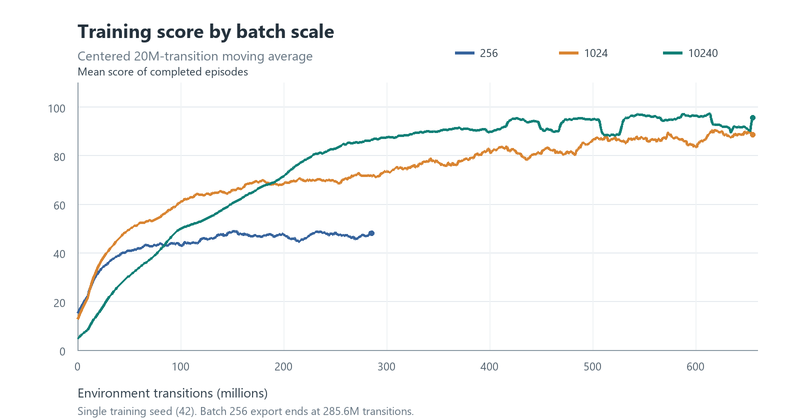
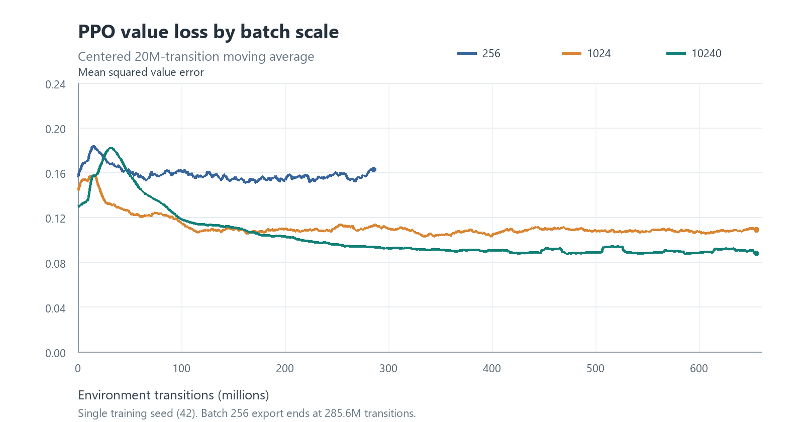
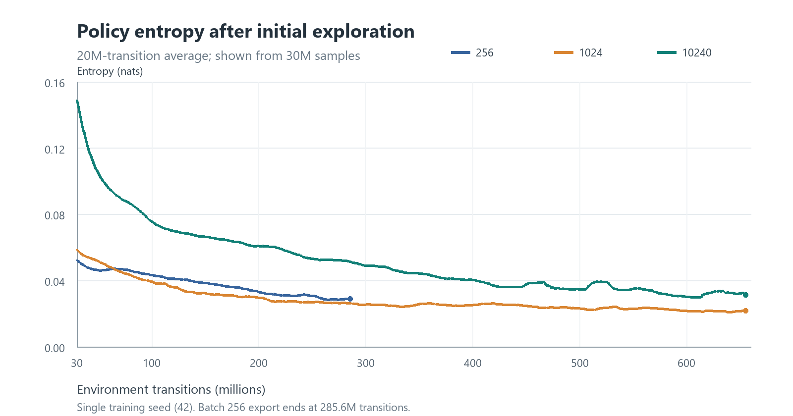

# PPO Snake (Rust)

This project uses a small Snake game to explore scaling behavior in reinforcement learning without requiring high-end hardware. A 12×12 board and a compact PPO actor–critic make it practical to run controlled experiments on a CPU, while `tch-rs` can also use an NVIDIA GPU. The experiments vary parallel environments and PPO batch sizes under a fixed planned environment-interaction budget, then compare score, value loss, and policy entropy.

Multiple environments advance in parallel with Rayon. Inference mode displays the game in a macroquad window.

## Batch scaling experiment

### Setup

The three E001 runs use a 12×12 board, 64 rollout steps per environment, a hidden size of 256, and one training seed (42). Their shared PPO settings are `learning_rate=3e-4`, `epochs=1`, `gamma=0.99`, `gae_lambda=0.95`, `clip_range=0.2`, `value_coef=1`, and `entropy_coef=0.001`. Each iteration collects `R = num_envs × rollout_steps` transitions. Each optimizer step uses a mini-batch of `b = ppo.batch_size` transitions.

| Run | Parallel environments | Rollout R | Mini-batch b | Optimizer steps per iteration | Planned iterations | Planned transitions | CSV coverage |
| --- | ---: | ---: | ---: | ---: | ---: | ---: | ---: |
| E001_s2 | 32 | 2,048 | 256 | 8 | 320,000 | 655,360,000 | 285,575,168 |
| E001_s1 | 128 | 8,192 | 1,024 | 8 | 80,000 | 655,360,000 | 655,360,000 |
| E001_s0 | 1,280 | 81,920 | 10,240 | 8 | 8,000 | 655,360,000 | 655,360,000 |

Evaluation is configured every 32,768,000 environment transitions, with 512 deterministic episodes capped at 5,000 steps each. The three supplied CSV exports contain **training metrics only**. The scores below are means over episodes completed during training, not independent evaluation scores.

### Results

Values for a sample interval are averaged by position on the cumulative-transition axis; M means one million transitions. “Best sustained score” is the highest average over a full 20M-transition window, rather than the highest single-iteration value. The batch-256 export ends at 285.6M, so it has no late-window result.

| Metric | Batch 256 | Batch 1,024 | Batch 10,240 |
| --- | ---: | ---: | ---: |
| Training score, 235–285M | 47.2 | 70.6 | 84.0 |
| Best sustained score, 20M window | 48.9 | 90.4 | 97.2 |
| Training score, 600–650M | — | 87.7 | 92.8 |
| Value loss, 235–285M | 0.157 | 0.110 | 0.095 |
| Value loss, 600–650M | — | 0.107 | 0.090 |
| Policy entropy, 235–285M | 0.030 | 0.027 | 0.053 |
| Policy entropy, 600–650M | — | 0.021 | 0.032 |



**Training score.** Over the shared 235–285M window, scores rise from 47.2 to 70.6 to 84.0 as batch and rollout size increase. At 600–650M, batch 1,024 averages 87.7 and batch 10,240 averages 92.8. Their best sustained scores are 90.4 and 97.2, respectively. These runs show higher observed performance at larger joint rollout and optimization scales. The batch-256 export does not show what happens beyond 285.6M.



**Value loss.** Over 235–285M, value loss falls from 0.157 to 0.110 to 0.095. At 600–650M, batch 10,240 remains lower than batch 1,024 (0.090 versus 0.107). This loss is the mean squared error between the value prediction and a GAE return target generated under the current policy. Because the target distribution changes as the policy learns, lower loss alone does not establish that better value predictions caused the score increase.



**Policy entropy.** Batch 10,240 retains more entropy: 0.053 over 235–285M, versus 0.027 for batch 1,024 and 0.030 for batch 256. Over 600–650M, the values are 0.032 and 0.021 for batches 10,240 and 1,024. Sustained stochasticity is a possible clue about exploration, but the batch-256 and batch-1,024 curves are not monotonic in batch size, and entropy alone cannot establish a cause. The entropy chart begins at 30M to make the low-entropy stage readable; all three runs start near `ln(4) ≈ 1.386`.

### Interpretation and limitations

The runs increase rollout size `R`, mini-batch size `b`, and the number of parallel environments together while keeping `R/b=8`. At the same planned transition budget, larger batches therefore use fewer policy refreshes and optimizer steps. The result measures **joint sampling and optimization scaling**. These runs cannot isolate the contributions of gradient noise, trajectory diversity, or update frequency. A useful next experiment would hold `R` fixed while varying `b`, then hold `b` fixed while varying `R`, with a learning-rate check for each setting.

The plotted lines use a **centered 20M-transition moving average**, rather than an average over W&B export rows. Both the plotted averages and table intervals use linear interpolation between adjacent export points and trapezoidal integration along the sample axis. At either plot edge, the averaging window is shortened to the available range; the best sustained score uses only complete 20M windows. The three exports align on sample coordinates for each batch and metric, have no duplicate sample coordinates or non-finite values, and contain 10,000 points each for batches 256 and 1,024 and 8,000 for batch 10,240.

Smoothing reveals the trajectory but provides no uncertainty estimate across training seeds. The training score includes only episodes completed in a given iteration; ongoing episodes are not counted yet. A replication should also compare `eval_samples/mean_score` on fixed evaluation seeds and repeat training with multiple independent seeds.

The aligned source data for the table and figures is in [docs/data/batch_experiment_metrics.csv](docs/data/batch_experiment_metrics.csv). Recalculate the summary and regenerate all three figures with [scripts/batch_scale_report.py](scripts/batch_scale_report.py):

```powershell
python -m pip install Pillow
python scripts/batch_scale_report.py
```

To import fresh W&B chart exports, pass all three CSV paths with `--score`, `--value-loss`, and `--entropy`.

## Setup (Windows)

1. Install the stable Rust toolchain with the MSVC target.
2. For GPU training, install an NVIDIA driver and a CUDA runtime compatible with LibTorch.
3. Download the LibTorch 2.7 CUDA build compatible with `tch = 0.20`. Set `LIBTORCH` to its directory and add `%LIBTORCH%\lib` to `PATH`. The project's `download-libtorch` feature is useful for CPU compilation and tests; GPU training should use a CUDA-enabled LibTorch build.
4. Install the W&B Python SDK:

```powershell
C:\Users\Liuluotu\Anaconda\anaconda3\python.exe -m pip install "wandb>=0.22.3"
```

5. To log online, configure `WANDB_API_KEY` in your environment or run `wandb login`. Keep the key out of YAML and source files.

## Configuration

The program always reads [config/config.yaml](config/config.yaml); there are no command-line training parameters. Common fields:

- `mode`: `train` or `infer`
- `device`: `cuda` or `cpu`; requesting unavailable CUDA produces an error
- `environment.num_envs`: number of parallel environments
- `environment.rollout_steps`: steps sampled per environment in each iteration
- `ppo.learning_rate`, `batch_size`, `epochs`: learning rate, optimizer mini-batch, and PPO epochs per rollout
- `training.total_iterations`: number of outer PPO iterations
- `evaluation.interval`: evaluation frequency in outer iterations
- `evaluation.episodes`: number of full episodes in each evaluation
- `evaluation.max_steps_per_episode`: per-episode evaluation limit to prevent looping policies from running indefinitely
- `wandb.mode`: `online` sync or `offline` local logging
- `wandb.enabled`: disable W&B when the Python SDK is unavailable
- `wandb.group`: optional experiment group; `null` leaves runs ungrouped

Each iteration collects exactly:

```text
num_envs * rollout_steps
```

Eating one food item gives a reward of `1.0`; all other outcomes, including death, give `0.0`.

## Training

Set the YAML to `mode: train` and choose `device: cpu` or `device: cuda`, then run:

```powershell
cargo run --release
```

Checkpoints are saved under `training.checkpoint_dir/run_name/`. For example, `run_name: snake-v1` produces `checkpoints/snake-v1/latest.ot`; `run_name: null` generates a unique run name.

W&B logs `train_samples/*` and `eval_samples/*` against cumulative transitions, and `train_iteration/*` and `eval_iteration/*` against outer iteration. The `recent_samples/*` and `recent_iteration/*` groups report fixed-window metrics on the corresponding axes. Window sizes come from `metrics.score_window_episodes` (recent completed episodes) and `metrics.transition_window_samples` (recent unique transitions). Before a window fills, it uses the data available so far; a window score is omitted when no episode has completed.

## Visual inference

Set the YAML to:

```yaml
mode: infer
inference:
  model_path: checkpoints/latest.ot
  fps: 10
  deterministic: true
  cell_size: 36
```

Then run `cargo run --release`. The window shows the snake, food, current score, and best score; close it to exit.

## Verification

```powershell
cargo fmt --all -- --check
cargo clippy --all-targets -- -D warnings
cargo test --all-targets
```

If CUDA is unavailable, check that your LibTorch build includes CUDA, the NVIDIA driver is compatible, and the LibTorch DLL directory is on `PATH`. If the W&B bridge cannot start, check `wandb.python_executable` and the `wandb` package in that Python environment.
