# Per-run experiment catalog

Snapshot downloaded 2026-11-09. Each section identifies the actual logged config, shows both evaluation and training scores, and states the supported interpretation. All runs use seed 42. Raw eval means are the primary performance measure; training scores are stochastic rolling-game metrics. The common protocol, single-seed limitations and diagnostic definitions are in the [main report](../../README.md) and [methods](methods.md).

The current catalog covers 31 runs. One retired architecture run remains in the 32-run data archive but is omitted from this report. C/D's `crashed` status is retained; no failure cause is invented. Best evals are retrospective diagnostics. Last-four means describe each run's own tail, not a common training budget.

## E001 A — `8qn5aaor`

[Open W&B run](https://wandb.ai/xlz1014361885-tokyo/ppo-snake/runs/8qn5aaor) · actual version **`mlp_v1`** · **eval early stop**.

**Experiment:** b=256, R=2,048, 32 environments × 64 steps, 1 PPO epoch(s), LR=0.0003, device `cpu`, hidden readout 256.

Observed logged training time: **5.35 h**; optimizer steps: **3,320,320**. Job times are not matched hardware benchmarks.

| Last training M | Last eval (at M) | Best eval (at M) | Last-four mean | Eval count |
| --- | --- | --- | --- | --- |
| 850 | 57.39 (850) | 67.94 (550) | 61.69 | 34 |

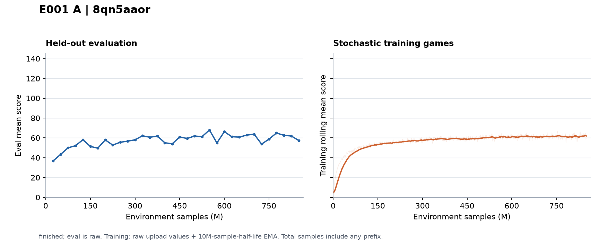

**Interpretation:** The small-scale baseline stays well below B/C's late score range. It stops after 12 evals without a new high; this does not establish an infinite-sample ceiling.

## E001 B — `1fl1l7hm`

[Open W&B run](https://wandb.ai/xlz1014361885-tokyo/ppo-snake/runs/1fl1l7hm) · actual version **`mlp_v1`** · **eval early stop**.

**Experiment:** b=1,024, R=8,192, 128 environments × 64 steps, 1 PPO epoch(s), LR=0.0003, device `cpu`, hidden readout 256.

Observed logged training time: **4.19 h**; optimizer steps: **1,147,464**. Job times are not matched hardware benchmarks.

| Last training M | Last eval (at M) | Best eval (at M) | Last-four mean | Eval count |
| --- | --- | --- | --- | --- |
| 1175 | 98.56 (1175) | 102.48 (875) | 97.82 | 47 |

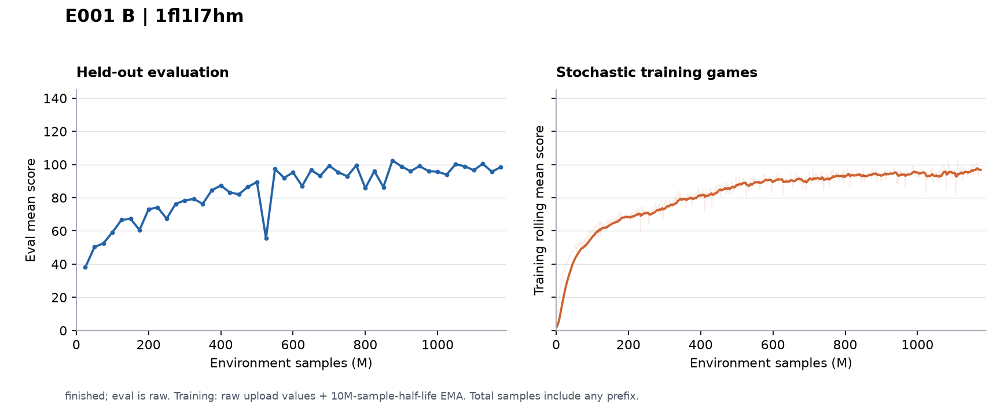

**Interpretation:** At fixed R=8,192, this larger mini-batch outperforms D over much of training. It also shows transient eval drops, so its best point should not stand in for the full trajectory.

## E001 C — `pqn9f1sl`

[Open W&B run](https://wandb.ai/xlz1014361885-tokyo/ppo-snake/runs/pqn9f1sl) · actual version **`mlp_v1`** · **sample cap**.

**Experiment:** b=10,240, R=81,920, 1,280 environments × 64 steps, 1 PPO epoch(s), LR=0.0003, device `cpu`, hidden readout 256.

Observed logged training time: **3.16 h**; optimizer steps: **117,192**. Job times are not matched hardware benchmarks.

| Last training M | Last eval (at M) | Best eval (at M) | Last-four mean | Eval count |
| --- | --- | --- | --- | --- |
| 1200 | 103.24 (1200) | 110.65 (1050) | 106.19 | 48 |

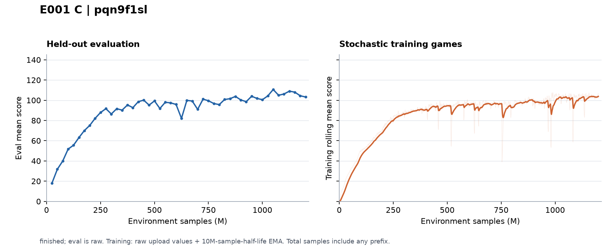

**Interpretation:** The largest joint scale has the highest observed E001 peak and late-four mean. It reaches the sample cap, with some regression after its peak; no asymptotic ceiling is measured.

## E001 D — `imrudw4e`

[Open W&B run](https://wandb.ai/xlz1014361885-tokyo/ppo-snake/runs/imrudw4e) · actual version **`mlp_v1`** · **eval early stop**.

**Experiment:** b=256, R=8,192, 128 environments × 64 steps, 1 PPO epoch(s), LR=0.0003, device `cpu`, hidden readout 256.

Observed logged training time: **2.88 h**; optimizer steps: **2,832,032**. Job times are not matched hardware benchmarks.

| Last training M | Last eval (at M) | Best eval (at M) | Last-four mean | Eval count |
| --- | --- | --- | --- | --- |
| 725 | 60.92 (725) | 65.83 (425) | 58.16 | 29 |

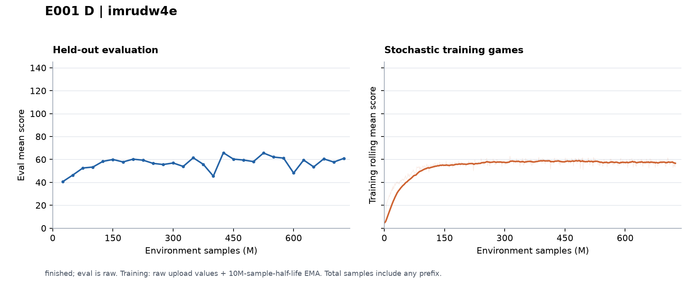

**Interpretation:** At fixed R=8,192 this b=256 run is much weaker than B. Increasing rollout relative to A does not produce a higher observed peak.

## E001 E — `ywj4sihn`

[Open W&B run](https://wandb.ai/xlz1014361885-tokyo/ppo-snake/runs/ywj4sihn) · actual version **`mlp_v1`** · **eval early stop**.

**Experiment:** b=1,024, R=81,920, 1,280 environments × 64 steps, 1 PPO epoch(s), LR=0.0003, device `cpu`, hidden readout 256.

Observed logged training time: **2.88 h**; optimizer steps: **1,098,640**. Job times are not matched hardware benchmarks.

| Last training M | Last eval (at M) | Best eval (at M) | Last-four mean | Eval count |
| --- | --- | --- | --- | --- |
| 1125 | 98.21 (1125) | 101.03 (825) | 84.71 | 45 |

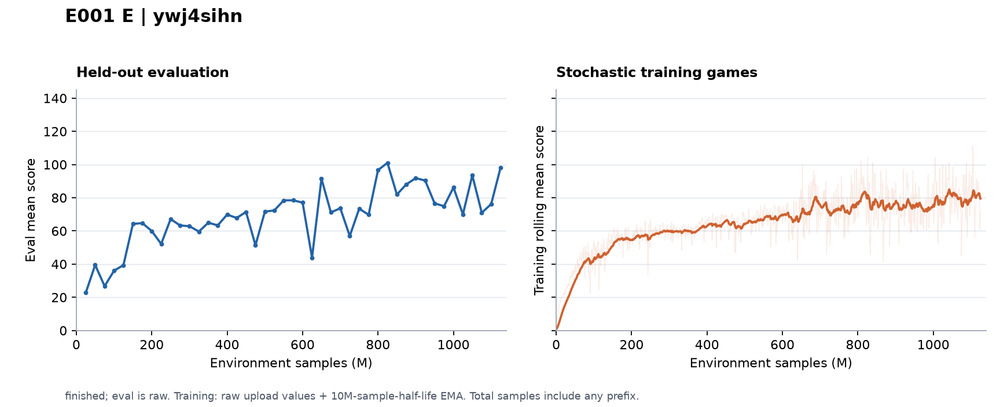

**Interpretation:** At fixed R=81,920 it trails C through much of the curve. Its last single eval rebounds to 98.21, but the last-four mean is only 84.71, illustrating endpoint sensitivity.

## E001 F — `9ag8xl46`

[Open W&B run](https://wandb.ai/xlz1014361885-tokyo/ppo-snake/runs/9ag8xl46) · actual version **`mlp_v1`** · **sample cap**.

**Experiment:** b=10,240, R=20,480, 320 environments × 64 steps, 1 PPO epoch(s), LR=0.0003, device `cpu`, hidden readout 256.

Observed logged training time: **3.21 h**; optimizer steps: **117,188**. Job times are not matched hardware benchmarks.

| Last training M | Last eval (at M) | Best eval (at M) | Last-four mean | Eval count |
| --- | --- | --- | --- | --- |
| 1200 | 96.64 (1200) | 99.58 (1125) | 97.17 | 48 |

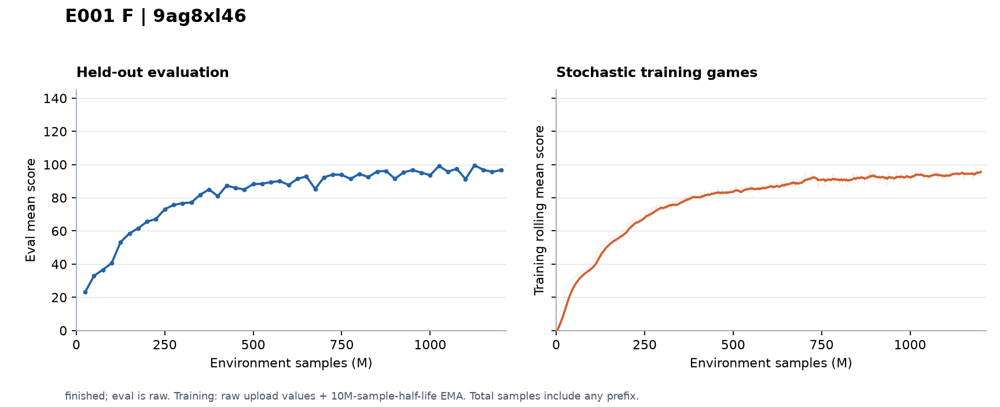

**Interpretation:** Compared with C at the same b=10,240 and 1,200M budget, the smaller rollout has lower last and last-four eval scores. This rollout benefit does not generalize to the b=256/1,024 comparisons.

## E002 A-ep2 — `243228id`

[Open W&B run](https://wandb.ai/xlz1014361885-tokyo/ppo-snake/runs/243228id) · actual version **`mlp_v1`** · **eval early stop**.

**Experiment:** b=256, R=2,048, 32 environments × 64 steps, 2 PPO epoch(s), LR=0.0003, device `cpu`, hidden readout 256.

Observed logged training time: **6.81 h**; optimizer steps: **6,445,328**. Job times are not matched hardware benchmarks.

| Last training M | Last eval (at M) | Best eval (at M) | Last-four mean | Eval count |
| --- | --- | --- | --- | --- |
| 825 | 35.25 (825) | 62.08 (525) | 31.49 | 33 |

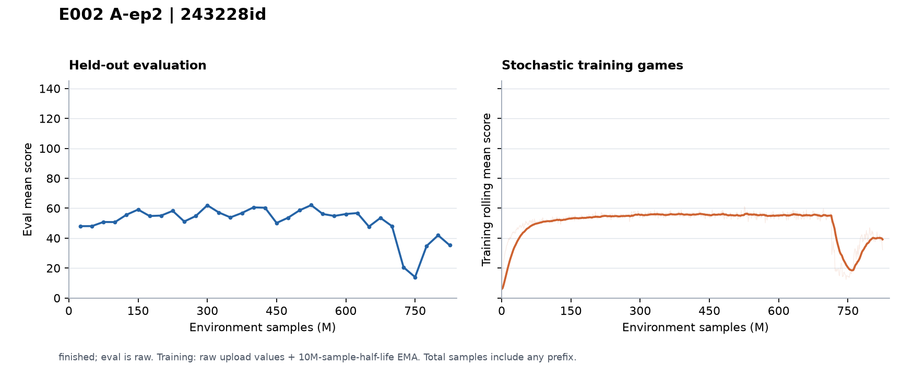

**Interpretation:** At the common 300M budget this is 3.95 points above the epoch-1 A baseline. The early advantage does not survive: both eval and training score fall sharply around 700–750M, followed by partial recovery. See the diagnostic case study in the main README.

## E002 A-ep4 — `cxnzx3v7`

[Open W&B run](https://wandb.ai/xlz1014361885-tokyo/ppo-snake/runs/cxnzx3v7) · actual version **`mlp_v1`** · **eval early stop**.

**Experiment:** b=256, R=2,048, 32 environments × 64 steps, 4 PPO epoch(s), LR=0.0003, device `cpu`, hidden readout 256.

Observed logged training time: **4.13 h**; optimizer steps: **5,859,392**. Job times are not matched hardware benchmarks.

| Last training M | Last eval (at M) | Best eval (at M) | Last-four mean | Eval count |
| --- | --- | --- | --- | --- |
| 375 | 19.14 (375) | 39.50 (75) | 11.96 | 15 |

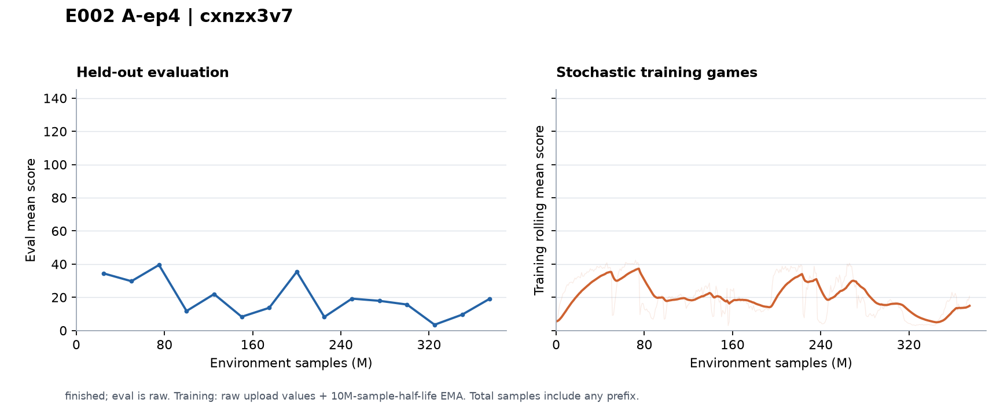

**Interpretation:** At the common 300M budget this is 42.39 points below the epoch-1 A baseline. It stops before the corresponding epoch-1 run and does not demonstrate a sustained improvement. More epochs also incur more optimizer work per sample.

## E002 A-ep8 — `gs8jmhi1`

[Open W&B run](https://wandb.ai/xlz1014361885-tokyo/ppo-snake/runs/gs8jmhi1) · actual version **`mlp_v1`** · **eval early stop**.

**Experiment:** b=256, R=2,048, 32 environments × 64 steps, 8 PPO epoch(s), LR=0.0003, device `cpu`, hidden readout 256.

Observed logged training time: **5.90 h**; optimizer steps: **10,156,288**. Job times are not matched hardware benchmarks.

| Last training M | Last eval (at M) | Best eval (at M) | Last-four mean | Eval count |
| --- | --- | --- | --- | --- |
| 325 | 1.15 (325) | 19.73 (25) | 1.74 | 13 |

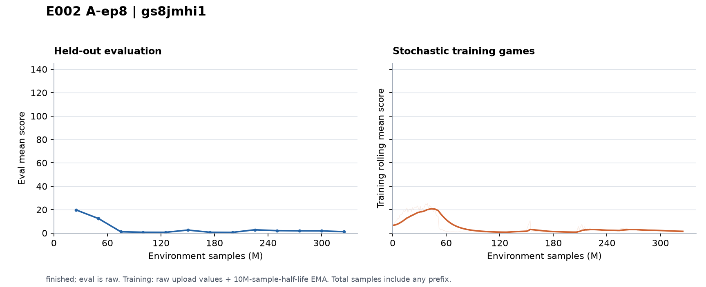

**Interpretation:** At the common 300M budget this is 56.19 points below the epoch-1 A baseline. The last eval is near 1: a severe regression under this unchanged-LR, high-reuse configuration.

## E002 B-ep2 — `w82bujg6`

[Open W&B run](https://wandb.ai/xlz1014361885-tokyo/ppo-snake/runs/w82bujg6) · actual version **`mlp_v1`** · **eval early stop**.

**Experiment:** b=1,024, R=8,192, 128 environments × 64 steps, 2 PPO epoch(s), LR=0.0003, device `cpu`, hidden readout 256.

Observed logged training time: **2.23 h**; optimizer steps: **1,123,056**. Job times are not matched hardware benchmarks.

| Last training M | Last eval (at M) | Best eval (at M) | Last-four mean | Eval count |
| --- | --- | --- | --- | --- |
| 575 | 69.12 (575) | 71.57 (275) | 68.99 | 23 |

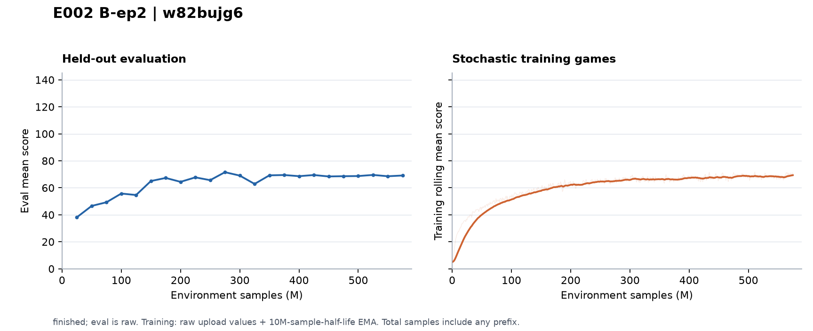

**Interpretation:** At the common 300M budget this is 9.33 points below the epoch-1 B baseline. It stops before the corresponding epoch-1 run and does not demonstrate a sustained improvement. More epochs also incur more optimizer work per sample.

## E002 B-ep4 — `vyhvyz65`

[Open W&B run](https://wandb.ai/xlz1014361885-tokyo/ppo-snake/runs/vyhvyz65) · actual version **`mlp_v1`** · **eval early stop**.

**Experiment:** b=1,024, R=8,192, 128 environments × 64 steps, 4 PPO epoch(s), LR=0.0003, device `cpu`, hidden readout 256.

Observed logged training time: **2.53 h**; optimizer steps: **1,660,160**. Job times are not matched hardware benchmarks.

| Last training M | Last eval (at M) | Best eval (at M) | Last-four mean | Eval count |
| --- | --- | --- | --- | --- |
| 425 | 62.68 (425) | 70.87 (125) | 64.01 | 17 |

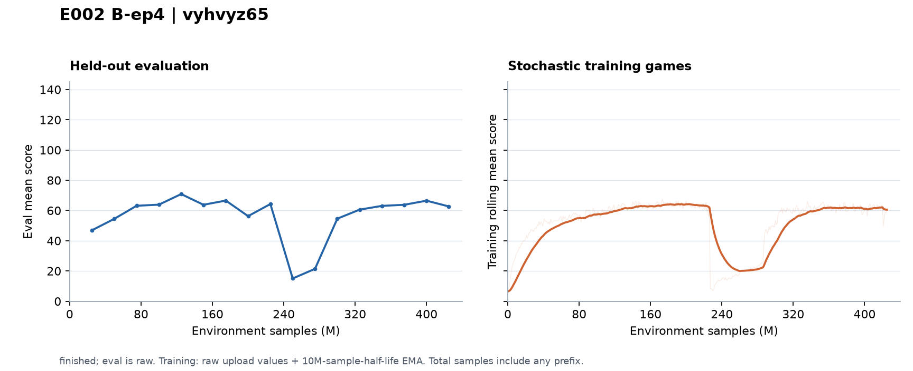

**Interpretation:** At the common 300M budget this is 23.78 points below the epoch-1 B baseline. It stops before the corresponding epoch-1 run and does not demonstrate a sustained improvement. More epochs also incur more optimizer work per sample.

## E002 B-ep8 — `27bpgubc`

[Open W&B run](https://wandb.ai/xlz1014361885-tokyo/ppo-snake/runs/27bpgubc) · actual version **`mlp_v1`** · **eval early stop**.

**Experiment:** b=1,024, R=8,192, 128 environments × 64 steps, 8 PPO epoch(s), LR=0.0003, device `cpu`, hidden readout 256.

Observed logged training time: **3.79 h**; optimizer steps: **3,320,320**. Job times are not matched hardware benchmarks.

| Last training M | Last eval (at M) | Best eval (at M) | Last-four mean | Eval count |
| --- | --- | --- | --- | --- |
| 425 | 1.06 (425) | 41.85 (125) | 2.96 | 17 |

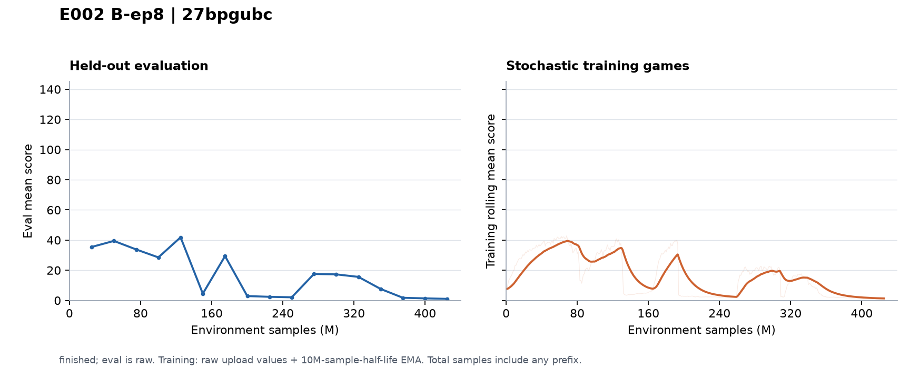

**Interpretation:** At the common 300M budget this is 61.09 points below the epoch-1 B baseline. The last eval is near 1: a severe regression under this unchanged-LR, high-reuse configuration.

## E002 C-ep2 — `lawmpttr`

[Open W&B run](https://wandb.ai/xlz1014361885-tokyo/ppo-snake/runs/lawmpttr) · actual version **`mlp_v1`** · **sample cap**.

**Experiment:** b=10,240, R=81,920, 1,280 environments × 64 steps, 2 PPO epoch(s), LR=0.0003, device `cpu`, hidden readout 256.

Observed logged training time: **4.00 h**; optimizer steps: **234,384**. Job times are not matched hardware benchmarks.

| Last training M | Last eval (at M) | Best eval (at M) | Last-four mean | Eval count |
| --- | --- | --- | --- | --- |
| 1200 | 107.87 (1200) | 107.92 (1175) | 105.63 | 48 |

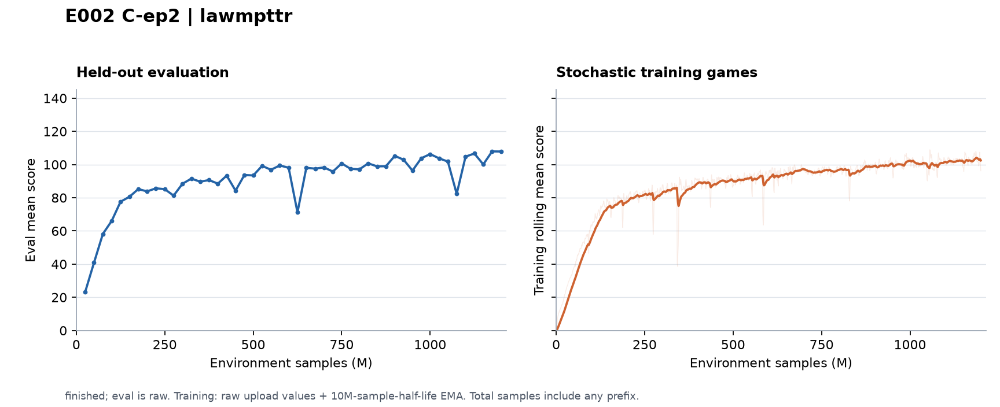

**Interpretation:** At the common 300M budget this is 1.99 points above the epoch-1 C baseline. Moderate reuse remains competitive at the large scale, but last, tail-average and best-point rankings differ; no clear general superiority over epoch 1 follows.

## E002 C-ep4 — `os6nv8lh`

[Open W&B run](https://wandb.ai/xlz1014361885-tokyo/ppo-snake/runs/os6nv8lh) · actual version **`mlp_v1`** · **sample cap**.

**Experiment:** b=10,240, R=81,920, 1,280 environments × 64 steps, 4 PPO epoch(s), LR=0.0003, device `cpu`, hidden readout 256.

Observed logged training time: **6.50 h**; optimizer steps: **468,768**. Job times are not matched hardware benchmarks.

| Last training M | Last eval (at M) | Best eval (at M) | Last-four mean | Eval count |
| --- | --- | --- | --- | --- |
| 1200 | 103.44 (1200) | 107.13 (1175) | 104.35 | 48 |

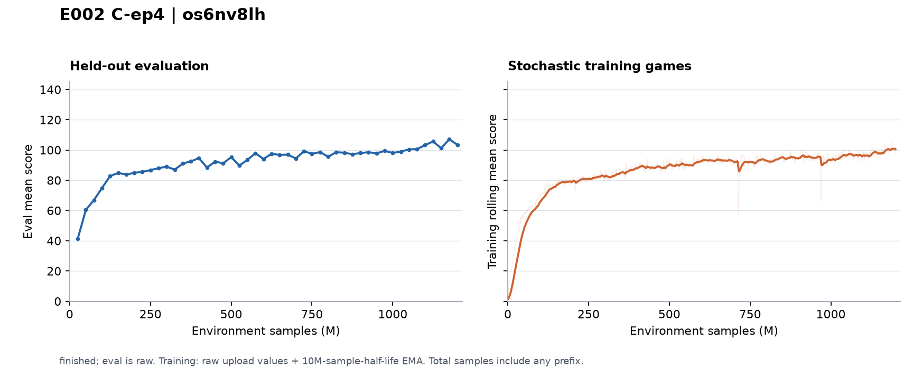

**Interpretation:** At the common 300M budget this is 2.53 points above the epoch-1 C baseline. Moderate reuse remains competitive at the large scale, but last, tail-average and best-point rankings differ; no clear general superiority over epoch 1 follows.

## E002 C-ep8 — `iknka9jp`

[Open W&B run](https://wandb.ai/xlz1014361885-tokyo/ppo-snake/runs/iknka9jp) · actual version **`mlp_v1`** · **eval early stop**.

**Experiment:** b=10,240, R=81,920, 1,280 environments × 64 steps, 8 PPO epoch(s), LR=0.0003, device `cpu`, hidden readout 256.

Observed logged training time: **7.61 h**; optimizer steps: **781,312**. Job times are not matched hardware benchmarks.

| Last training M | Last eval (at M) | Best eval (at M) | Last-four mean | Eval count |
| --- | --- | --- | --- | --- |
| 1000 | 57.95 (1000) | 95.14 (700) | 51.22 | 40 |

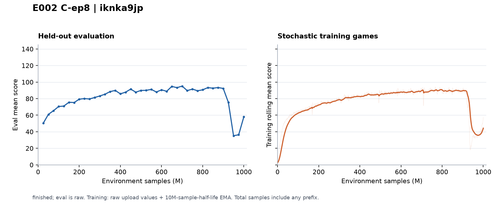

**Interpretation:** At the common 300M budget this is 3.22 points below the epoch-1 C baseline. The large scale delays rather than eliminates degradation at eight epochs; the trajectory ends substantially below its peak.

## E003 A-100M-to-B — `dqjtc7nx`

[Open W&B run](https://wandb.ai/xlz1014361885-tokyo/ppo-snake/runs/dqjtc7nx) · actual version **`mlp_v1`** · **eval early stop**.

**Experiment:** b=1,024, R=8,192, 128 environments × 64 steps, 1 PPO epoch(s), LR=0.0003, device `cpu`, hidden readout 256.

Observed logged training time: **2.70 h**; optimizer steps: **854,496**. Job times are not matched hardware benchmarks.

Initialized from `checkpoints/E001_batch_rollout_scale_exp-A/samples-100001792.ot` after 100M prefix samples; weights-only loading resets Adam. Training can add up to 1,200M samples, subject to eval early stopping.

| Last training M | Last eval (at M) | Best eval (at M) | Last-four mean | Eval count |
| --- | --- | --- | --- | --- |
| 975 | 67.91 (975) | 70.17 (675) | 67.65 | 36 |

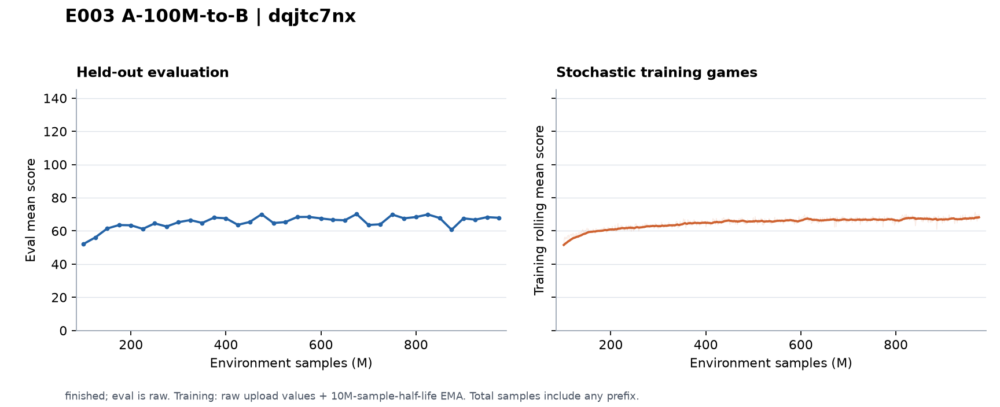

**Interpretation:** After +300M the score is 67.61, versus 52.12 at the switch. The branch improves, but the observed continuation does not reach the destination-from-scratch late range. This is finite-budget path dependence, with Adam reset and no same-scale reset control.

## E003 A-100M-to-C — `kg14yclt`

[Open W&B run](https://wandb.ai/xlz1014361885-tokyo/ppo-snake/runs/kg14yclt) · actual version **`mlp_v1`** · **sample cap**.

**Experiment:** b=10,240, R=81,920, 1,280 environments × 64 steps, 1 PPO epoch(s), LR=0.0003, device `cpu`, hidden readout 256.

Observed logged training time: **2.79 h**; optimizer steps: **117,192**. Job times are not matched hardware benchmarks.

Initialized from `checkpoints/E001_batch_rollout_scale_exp-A/samples-100001792.ot` after 100M prefix samples; weights-only loading resets Adam. Training can add up to 1,200M samples, subject to eval early stopping.

| Last training M | Last eval (at M) | Best eval (at M) | Last-four mean | Eval count |
| --- | --- | --- | --- | --- |
| 1300 | 83.95 (1300) | 83.95 (1300) | 77.28 | 49 |

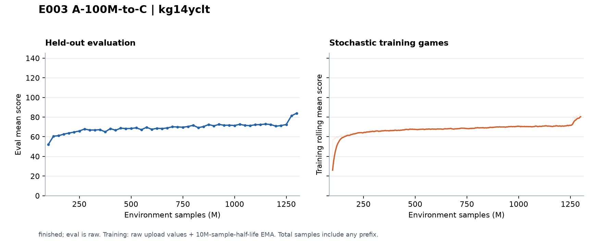

**Interpretation:** After +300M the score is 68.30, versus 52.12 at the switch. The branch improves, but the observed continuation does not reach the destination-from-scratch late range. This is finite-budget path dependence, with Adam reset and no same-scale reset control.

## E003 A-300M-to-B — `0kz667ok`

[Open W&B run](https://wandb.ai/xlz1014361885-tokyo/ppo-snake/runs/0kz667ok) · actual version **`mlp_v1`** · **eval early stop**.

**Experiment:** b=1,024, R=8,192, 128 environments × 64 steps, 1 PPO epoch(s), LR=0.0003, device `cpu`, hidden readout 256.

Observed logged training time: **1.61 h**; optimizer steps: **512,696**. Job times are not matched hardware benchmarks.

Initialized from `checkpoints/E001_batch_rollout_scale_exp-A/samples-300001280.ot` after 300M prefix samples; weights-only loading resets Adam. Training can add up to 1,200M samples, subject to eval early stopping.

| Last training M | Last eval (at M) | Best eval (at M) | Last-four mean | Eval count |
| --- | --- | --- | --- | --- |
| 825 | 69.10 (825) | 69.54 (525) | 66.86 | 22 |

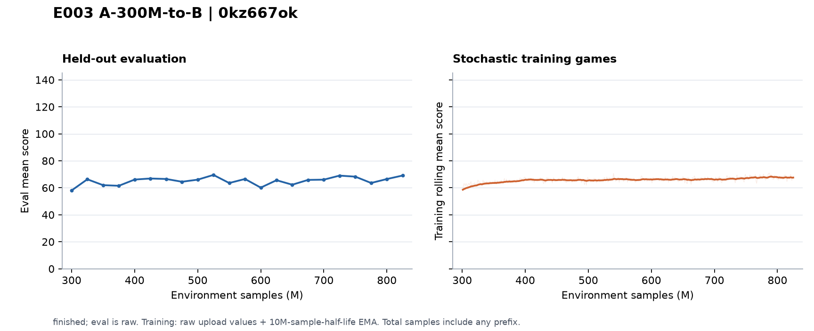

**Interpretation:** After +300M the score is 60.13, versus 58.03 at the switch. The branch improves, but the observed continuation does not reach the destination-from-scratch late range. This is finite-budget path dependence, with Adam reset and no same-scale reset control.

## E003 A-300M-to-C — `4rq43nzz`

[Open W&B run](https://wandb.ai/xlz1014361885-tokyo/ppo-snake/runs/4rq43nzz) · actual version **`mlp_v1`** · **sample cap**.

**Experiment:** b=10,240, R=81,920, 1,280 environments × 64 steps, 1 PPO epoch(s), LR=0.0003, device `cpu`, hidden readout 256.

Observed logged training time: **2.89 h**; optimizer steps: **117,192**. Job times are not matched hardware benchmarks.

Initialized from `checkpoints/E001_batch_rollout_scale_exp-A/samples-300001280.ot` after 300M prefix samples; weights-only loading resets Adam. Training can add up to 1,200M samples, subject to eval early stopping.

| Last training M | Last eval (at M) | Best eval (at M) | Last-four mean | Eval count |
| --- | --- | --- | --- | --- |
| 1500 | 93.87 (1500) | 98.46 (1475) | 95.38 | 49 |

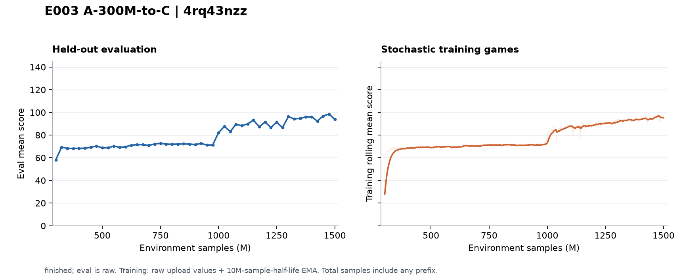

**Interpretation:** After +300M the score is 69.71, versus 58.03 at the switch. The branch improves, but the observed continuation does not reach the destination-from-scratch late range. This is finite-budget path dependence, with Adam reset and no same-scale reset control.

## E003 A-550M-to-B — `tsuw61ly`

[Open W&B run](https://wandb.ai/xlz1014361885-tokyo/ppo-snake/runs/tsuw61ly) · actual version **`mlp_v1`** · **eval early stop**.

**Experiment:** b=1,024, R=8,192, 128 environments × 64 steps, 1 PPO epoch(s), LR=0.0003, device `cpu`, hidden readout 256.

Observed logged training time: **3.57 h**; optimizer steps: **1,123,048**. Job times are not matched hardware benchmarks.

Initialized from `checkpoints/E001_batch_rollout_scale_exp-A/samples-550000640.ot` after 550M prefix samples; weights-only loading resets Adam. Training can add up to 1,200M samples, subject to eval early stopping.

| Last training M | Last eval (at M) | Best eval (at M) | Last-four mean | Eval count |
| --- | --- | --- | --- | --- |
| 1700 | 72.07 (1700) | 72.22 (1400) | 70.53 | 47 |

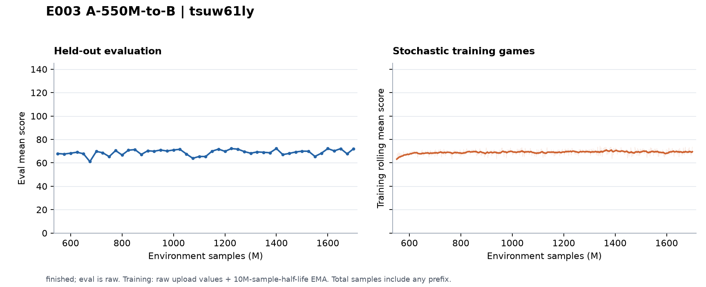

**Interpretation:** After +300M the score is 71.32, versus 67.94 at the switch. The branch improves, but the observed continuation does not reach the destination-from-scratch late range. This is finite-budget path dependence, with Adam reset and no same-scale reset control.

## E003 A-550M-to-C — `7436yevl`

[Open W&B run](https://wandb.ai/xlz1014361885-tokyo/ppo-snake/runs/7436yevl) · actual version **`mlp_v1`** · **eval early stop**.

**Experiment:** b=10,240, R=81,920, 1,280 environments × 64 steps, 1 PPO epoch(s), LR=0.0003, device `cpu`, hidden readout 256.

Observed logged training time: **2.97 h**; optimizer steps: **117,192**. Job times are not matched hardware benchmarks.

Initialized from `checkpoints/E001_batch_rollout_scale_exp-A/samples-550000640.ot` after 550M prefix samples; weights-only loading resets Adam. Training can add up to 1,200M samples, subject to eval early stopping.

| Last training M | Last eval (at M) | Best eval (at M) | Last-four mean | Eval count |
| --- | --- | --- | --- | --- |
| 1750 | 75.60 (1750) | 77.98 (1450) | 76.58 | 49 |

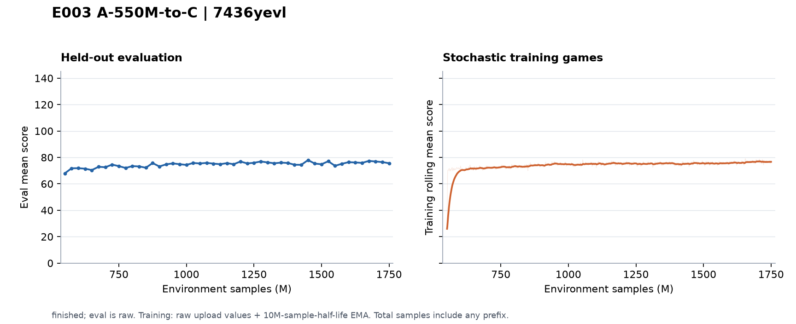

**Interpretation:** After +300M the score is 72.22, versus 67.94 at the switch. The branch improves, but the observed continuation does not reach the destination-from-scratch late range. This is finite-budget path dependence, with Adam reset and no same-scale reset control.

## E003 B-200M-to-C — `tgfr335x`

[Open W&B run](https://wandb.ai/xlz1014361885-tokyo/ppo-snake/runs/tgfr335x) · actual version **`mlp_v1`** · **sample cap**.

**Experiment:** b=10,240, R=81,920, 1,280 environments × 64 steps, 1 PPO epoch(s), LR=0.0003, device `cpu`, hidden readout 256.

Observed logged training time: **3.27 h**; optimizer steps: **117,192**. Job times are not matched hardware benchmarks.

Initialized from `checkpoints/E001_batch_rollout_scale_exp-B/samples-200007680.ot` after 200M prefix samples; weights-only loading resets Adam. Training can add up to 1,200M samples, subject to eval early stopping.

| Last training M | Last eval (at M) | Best eval (at M) | Last-four mean | Eval count |
| --- | --- | --- | --- | --- |
| 1400 | 97.71 (1400) | 101.61 (1300) | 99.09 | 49 |

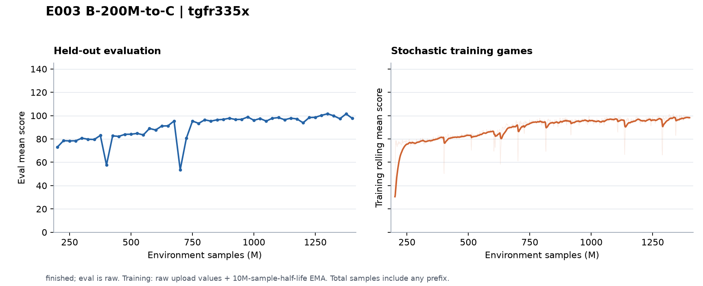

**Interpretation:** After +300M the score is 84.06, versus 73.01 at the switch. The branch reaches the large-scale score range. Its pretraining cost must be included before comparing sample efficiency against C from scratch.

## E003 B-500M-to-C — `14fyacu6`

[Open W&B run](https://wandb.ai/xlz1014361885-tokyo/ppo-snake/runs/14fyacu6) · actual version **`mlp_v1`** · **sample cap**.

**Experiment:** b=10,240, R=81,920, 1,280 environments × 64 steps, 1 PPO epoch(s), LR=0.0003, device `cpu`, hidden readout 256.

Observed logged training time: **3.46 h**; optimizer steps: **117,192**. Job times are not matched hardware benchmarks.

Initialized from `checkpoints/E001_batch_rollout_scale_exp-B/samples-500006912.ot` after 500M prefix samples; weights-only loading resets Adam. Training can add up to 1,200M samples, subject to eval early stopping.

| Last training M | Last eval (at M) | Best eval (at M) | Last-four mean | Eval count |
| --- | --- | --- | --- | --- |
| 1700 | 108.12 (1700) | 110.61 (1625) | 108.75 | 49 |

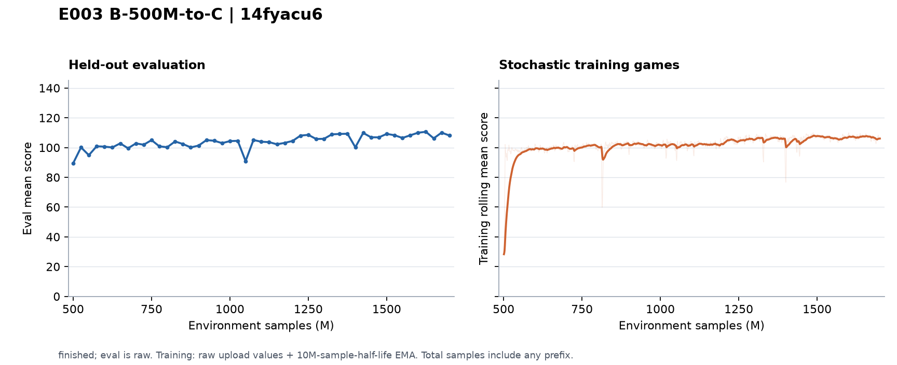

**Interpretation:** After +300M the score is 100.25, versus 89.45 at the switch. The branch reaches the large-scale score range. Its pretraining cost must be included before comparing sample efficiency against C from scratch.

## E003 B-850M-to-C — `myl98rs7`

[Open W&B run](https://wandb.ai/xlz1014361885-tokyo/ppo-snake/runs/myl98rs7) · actual version **`mlp_v1`** · **eval early stop**.

**Experiment:** b=10,240, R=81,920, 1,280 environments × 64 steps, 1 PPO epoch(s), LR=0.0003, device `cpu`, hidden readout 256.

Observed logged training time: **1.40 h**; optimizer steps: **46,392**. Job times are not matched hardware benchmarks.

Initialized from `checkpoints/E001_batch_rollout_scale_exp-B/samples-850001920.ot` after 850M prefix samples; weights-only loading resets Adam. Training can add up to 1,200M samples, subject to eval early stopping.

| Last training M | Last eval (at M) | Best eval (at M) | Last-four mean | Eval count |
| --- | --- | --- | --- | --- |
| 1325 | 106.01 (1325) | 107.42 (1025) | 105.08 | 20 |

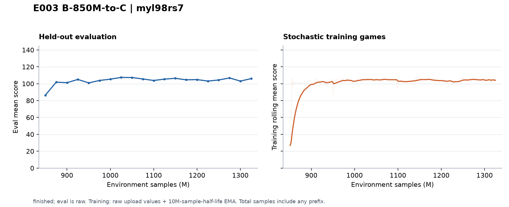

**Interpretation:** After +300M the score is 106.37, versus 86.43 at the switch. The branch reaches the large-scale score range. Its pretraining cost must be included before comparing sample efficiency against C from scratch.

## E003 C-150M-to-B — `atb499b6`

[Open W&B run](https://wandb.ai/xlz1014361885-tokyo/ppo-snake/runs/atb499b6) · actual version **`mlp_v1`** · **eval early stop**.

**Experiment:** b=1,024, R=8,192, 128 environments × 64 steps, 1 PPO epoch(s), LR=0.0003, device `cpu`, hidden readout 256.

Observed logged training time: **1.73 h**; optimizer steps: **463,872**. Job times are not matched hardware benchmarks.

Initialized from `checkpoints/E001_batch_rollout_scale_exp-C/samples-150077440.ot` after 150M prefix samples; weights-only loading resets Adam. Training can add up to 1,200M samples, subject to eval early stopping.

| Last training M | Last eval (at M) | Best eval (at M) | Last-four mean | Eval count |
| --- | --- | --- | --- | --- |
| 625 | 97.53 (625) | 98.32 (325) | 92.73 | 20 |

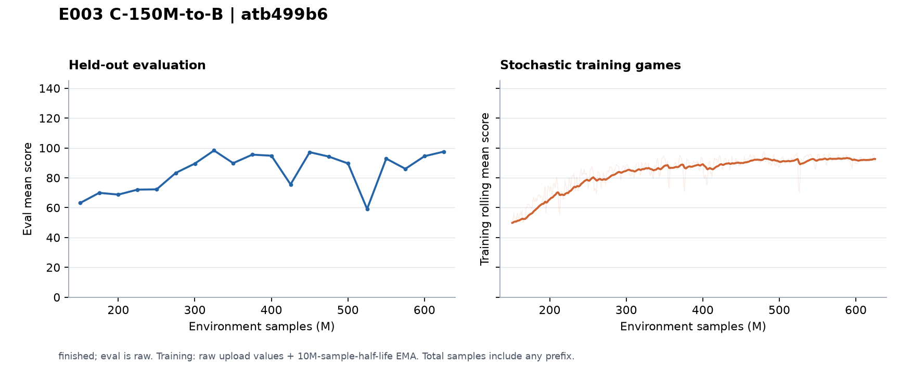

**Interpretation:** After +300M the score is 97.18, versus 63.12 at the switch. A strong policy can retain or improve high scores after lowering the scale, contradicting a simple rule that the current batch alone fixes attainable performance.

## E003 C-450M-to-B — `27xxfqi2`

[Open W&B run](https://wandb.ai/xlz1014361885-tokyo/ppo-snake/runs/27xxfqi2) · actual version **`mlp_v1`** · **eval early stop**.

**Experiment:** b=1,024, R=8,192, 128 environments × 64 steps, 1 PPO epoch(s), LR=0.0003, device `cpu`, hidden readout 256.

Observed logged training time: **1.18 h**; optimizer steps: **292,976**. Job times are not matched hardware benchmarks.

Initialized from `checkpoints/E001_batch_rollout_scale_exp-C/samples-450068480.ot` after 450M prefix samples; weights-only loading resets Adam. Training can add up to 1,200M samples, subject to eval early stopping.

| Last training M | Last eval (at M) | Best eval (at M) | Last-four mean | Eval count |
| --- | --- | --- | --- | --- |
| 750 | 93.82 (750) | 100.13 (450) | 94.62 | 13 |

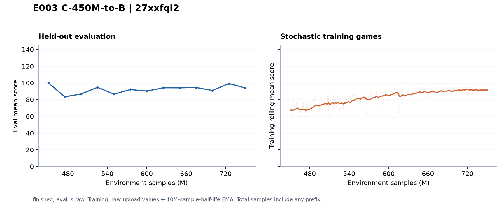

**Interpretation:** After +300M the score is 93.82, versus 100.13 at the switch. No later eval exceeds the initial 100.13; the branch stops after the patience window. Lowering the scale does not improve this particular strong starting policy.

## E003 C-850M-to-B — `op3gdb5t`

[Open W&B run](https://wandb.ai/xlz1014361885-tokyo/ppo-snake/runs/op3gdb5t) · actual version **`mlp_v1`** · **eval early stop**.

**Experiment:** b=1,024, R=8,192, 128 environments × 64 steps, 1 PPO epoch(s), LR=0.0003, device `cpu`, hidden readout 256.

Observed logged training time: **3.24 h**; optimizer steps: **830,080**. Job times are not matched hardware benchmarks.

Initialized from `checkpoints/E001_batch_rollout_scale_exp-C/samples-850001920.ot` after 850M prefix samples; weights-only loading resets Adam. Training can add up to 1,200M samples, subject to eval early stopping.

| Last training M | Last eval (at M) | Best eval (at M) | Last-four mean | Eval count |
| --- | --- | --- | --- | --- |
| 1700 | 105.31 (1700) | 108.28 (1400) | 103.14 | 35 |

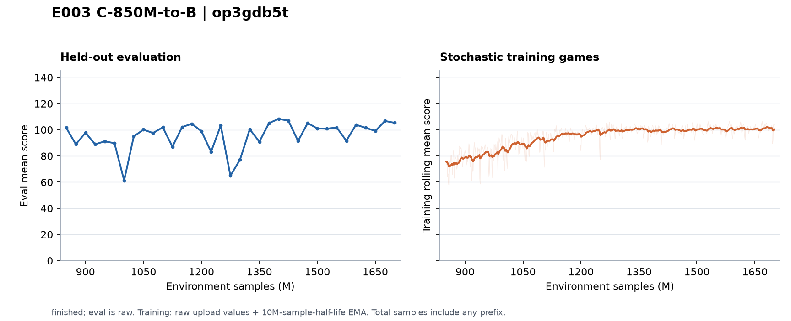

**Interpretation:** After +300M the score is 102.06, versus 101.57 at the switch. A strong policy can retain or improve high scores after lowering the scale, contradicting a simple rule that the current batch alone fixes attainable performance.

## E004 A — `k7ceg6iz`

[Open W&B run](https://wandb.ai/xlz1014361885-tokyo/ppo-snake/runs/k7ceg6iz) · actual version **`cnn_v1`** · **sample cap**.

**Experiment:** b=10,240, R=81,920, 1,280 environments × 64 steps, 1 PPO epoch(s), LR=0.0003, device `cpu`, hidden readout 256.

Observed logged training time: **5.55 h**; optimizer steps: **117,192**. Job times are not matched hardware benchmarks.

| Last training M | Last eval (at M) | Best eval (at M) | Last-four mean | Eval count |
| --- | --- | --- | --- | --- |
| 1200 | 74.42 (1200) | 75.23 (1175) | 72.49 | 48 |

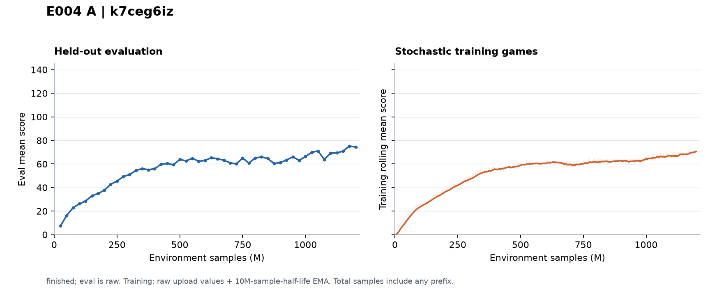

**Interpretation:** This CNN does not improve on the MLP at the matched 1,200M endpoint. The result concerns this architecture and fixed training protocol, not all convolutional policies.

## E004 B — `7w4f2mfc`

[Open W&B run](https://wandb.ai/xlz1014361885-tokyo/ppo-snake/runs/7w4f2mfc) · actual version **`transformer_v7`** · **eval early stop**.

**Experiment:** b=10,240, R=81,920, 1,280 environments × 64 steps, 1 PPO epoch(s), LR=0.0003, device `cuda`, hidden readout 256.

Observed logged training time: **10.00 h**; optimizer steps: **56,160**. Job times are not matched hardware benchmarks.

| Last training M | Last eval (at M) | Best eval (at M) | Last-four mean | Eval count |
| --- | --- | --- | --- | --- |
| 575 | 71.62 (575) | 125.55 (275) | 82.44 | 23 |

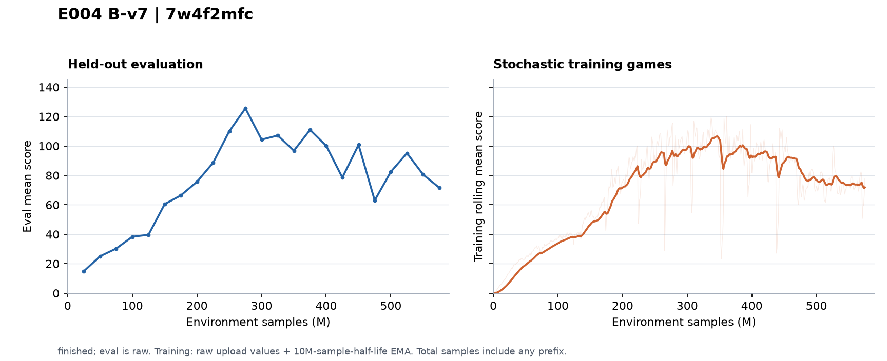

**Interpretation:** The entity small model exceeds the MLP's observed best score, then regresses by 53.93 points from its peak to the last eval. Its entropy is not monotonically vanishing during that late regression. The current name for this architecture is transformer_v1_small.

## E004 C — `jokwhg5k`

[Open W&B run](https://wandb.ai/xlz1014361885-tokyo/ppo-snake/runs/jokwhg5k) · actual version **`transformer_v1_base`** · **crashed (partial)**.

**Experiment:** b=10,240, R=81,920, 1,280 environments × 64 steps, 1 PPO epoch(s), LR=0.0003, device `cuda`, hidden readout 256.

Observed logged training time: **10.17 h**; optimizer steps: **40,920**. Job times are not matched hardware benchmarks.

| Last training M | Last eval (at M) | Best eval (at M) | Last-four mean | Eval count |
| --- | --- | --- | --- | --- |
| 419 | 132.94 (400) | 132.94 (400) | 130.21 | 16 |

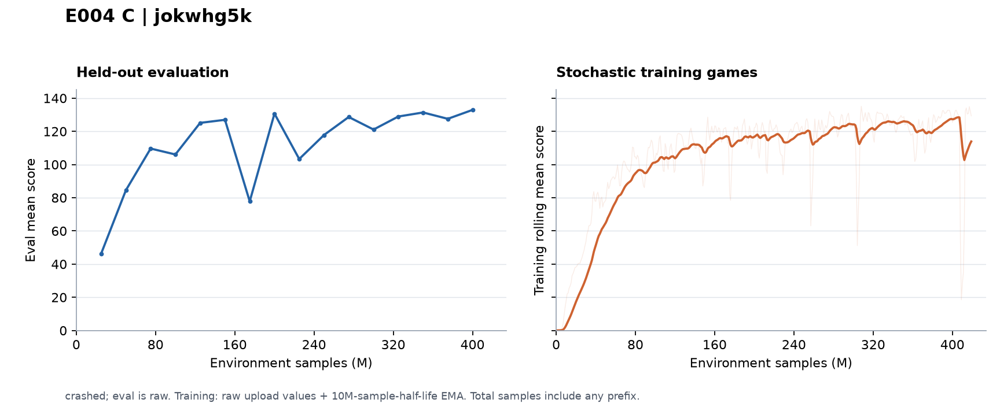

**Interpretation:** The base entity model exceeds the MLP's range early and has the highest observed mean in the export. W&B marks the run crashed at 419M, with last eval at 400M. After that eval the training rolling score falls to 18.49 at 409M and recovers to 129.32 by 419M; no later eval assesses that event. Interruption cause and later stability are unknown.

## E004 D — `y7o6jbpw`

[Open W&B run](https://wandb.ai/xlz1014361885-tokyo/ppo-snake/runs/y7o6jbpw) · actual version **`transformer_v1_small`** · **crashed (partial)**.

**Experiment:** b=10,240, R=81,920, 1,280 environments × 64 steps, 1 PPO epoch(s), LR=0.0003, device `cuda`, hidden readout 256.

Observed logged training time: **17.31 h**; optimizer steps: **90,336**. Job times are not matched hardware benchmarks.

Frozen self-teacher initialized at first eval; strictly higher eval means replace it. Forward KL teacher→student, coefficient 0.001, no critic distillation or coefficient decay.

| Last training M | Last eval (at M) | Best eval (at M) | Last-four mean | Eval count |
| --- | --- | --- | --- | --- |
| 925 | 131.55 (925) | 131.90 (800) | 125.65 | 37 |

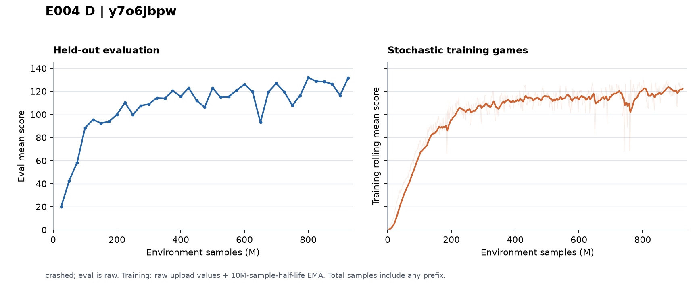

**Interpretation:** At the common 575M point it scores 120.82 versus 71.62 without the teacher, then continues to high scores. It still has large downward excursions, and the first pre-KL evaluation differs between runs. The evidence supports a promising direction, not clean attribution or a completed-run stability claim.
